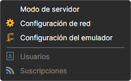
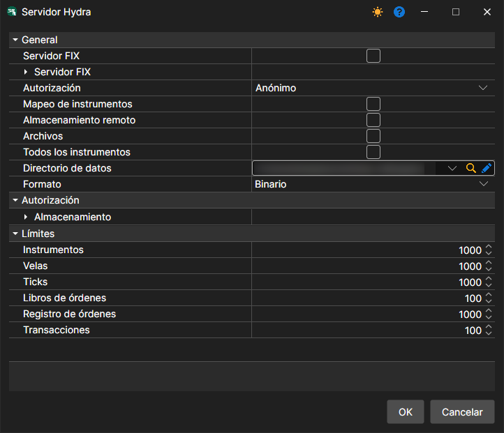
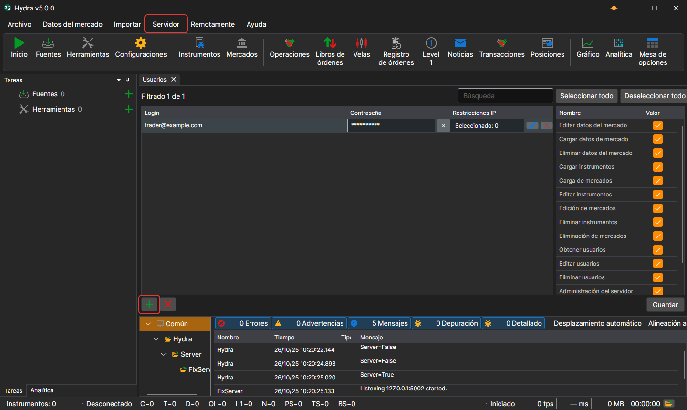

# Configuración

[Hydra](../../hydra.md) puede usarse en modo servidor; en este modo puede conectarse remotamente a [Hydra](../../hydra.md) y obtener los datos existentes en el almacenamiento. Puede conectarse a [Hydra](../../hydra.md) ejecutado en modo servidor desde [Designer](../../designer.md) (consulte [Primeros pasos](../../designer/market_data_storage/getting_started.md) en la documentación de [Designer](../../designer.md) para saber cómo hacerlo). También puede conectarse a [Hydra](../../hydra.md) mediante la [API](../../api.md) (consulte la sección [Conectividad FIX/FAST](fix_fast_connectivity.md) para más detalles).

En modo servidor, el programa [Hydra](../../hydra.md) permite al usuario trabajar con una conexión desde varios programas a la vez. Al establecer la clave de acceso en la configuración del programa, el usuario puede trabajar simultáneamente con una fuente bajo una misma cuenta.

En la práctica, la conexión a la fuente se produce a través de [Hydra](../../hydra.md), al que, por ejemplo, se conectan simultáneamente [Designer](../../designer.md) y [Terminal](../../terminal.md). Este método permite evitar reconexiones entre programas y la compra de una conexión adicional. Con este trabajo se excluyen conflictos que pueden surgir por el registro de órdenes u operaciones desde distintos programas. [Hydra](../../hydra.md) recibe la señal y devuelve el resultado al programa desde el que se recibió, sin alterar la secuencia del resto del trabajo.

Para habilitar el modo servidor de [Hydra](../../hydra.md), en el menú **Servidor** seleccione la opción **Modo servidor**.

Después, en el mismo menú, seleccione la opción **Configuración de red**: se abrirá la ventana de configuración del modo servidor.

**Servidor Hydra**

- **Servidor FIX** - cambiar [Hydra](../../hydra.md) al modo servidor, distribuyendo negociación en vivo y datos históricos mediante el protocolo FIX.

  En esta sección se configura la conexión para trabajar con fuentes:
  1. **ConvertToLatin** - convertir cirílico a latín.
  2. **QuotesInterval** - período de actualización de cotizaciones.
  3. **TransactionSession** - configuración de una sesión de negociación. Configuración para operar mediante el programa [Hydra](../../hydra.md).

     Este ajuste permite configurar el dialecto del protocolo FIX, remitente y destinatario, formato de datos y otros parámetros. Consulte [Propiedades de FIXServer](https://doc.stocksharp.com/html/Properties_T_StockSharp_Fix_FixServer.htm) para más detalles.
  4. **MarketDataSession** - configuración para transferir datos de mercado recibidos mediante [Hydra](../../hydra.md). Consulte [Propiedades de FIXServer](https://doc.stocksharp.com/html/Properties_T_StockSharp_Fix_FixServer.htm) para más detalles.
  5. **KeepSubscriptionsOnDisconnect** - conservar suscripciones al desconectarse de la fuente.
  6. **DeadSessionCleanupInterval** - intervalo tras el cual se limpiará la información si la conexión está desconectada.
- **Autorización** - autorización para obtener acceso al servidor Hydra.
- **Almacenamiento** (grupo **Autorización**) - dónde se guardan los usuarios del servidor: **Archivo** o **Base de datos**. Para la base de datos se indican la **Conexión** a ella y la **Tabla** (por defecto, **HydraUsers**); en la base de datos no se guardan las contraseñas en sí, sino sus hashes.
- **Número de instrumentos** - número máximo de instrumentos que se pueden solicitar al servidor.
- **Velas (días)** - número máximo de días disponibles para descargar historial de velas.
- **Ticks (días)** - número máximo de días disponibles para descargar historial de datos tick.
- **Libros de órdenes (días)** - número máximo de días disponibles para descargar historial del libro de órdenes.
- **OL (días)** - número máximo de días disponibles para descargar historial de datos OL.
- **Transacciones (días)** - número máximo de días disponibles para descargar historial de transacciones.
- **Simulador** - activar el modo simulador.
- **Mapeo de instrumentos** - habilitar el modo de transferencia solo para los instrumentos especificados.

Si establece **Autorización** en un valor distinto de **Anónimo** y habilita el **Modo servidor**, en el menú **Servidor** estará disponible la opción **Usuarios**, que abre la ventana **Usuarios**.

En la parte izquierda de la ventana está la lista de usuarios: **Añadir** crea uno nuevo, **Eliminar** quita el seleccionado y **Guardar** guarda los cambios. A la derecha están el correo y la contraseña del usuario seleccionado, las direcciones desde las que puede conectarse y sus derechos: cada uno se marca con una casilla, y **Seleccionar todo** y **Deseleccionar todo** los marcan o desmarcan todos a la vez.

Mientras el servidor está en funcionamiento, en el menú **Servidor** está disponible la opción **Suscripciones**: abre un panel con las suscripciones a datos de mercado de los clientes conectados al servidor.
