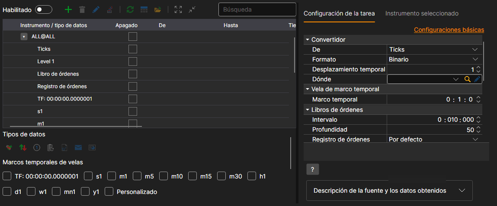
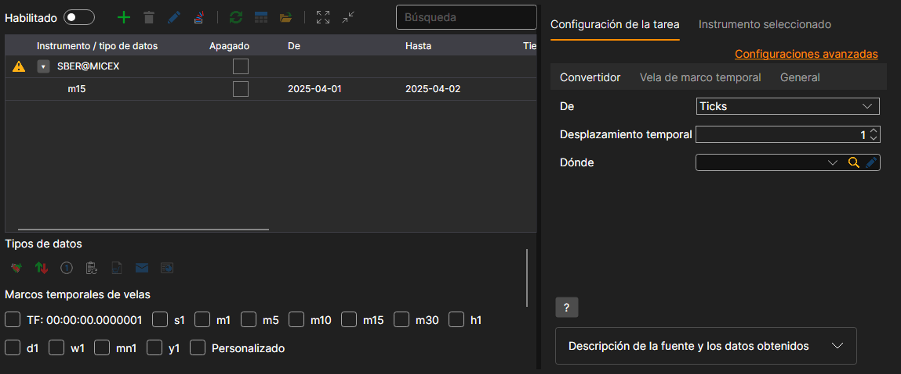
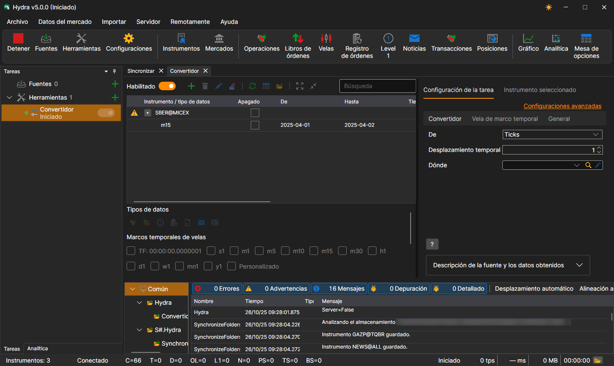
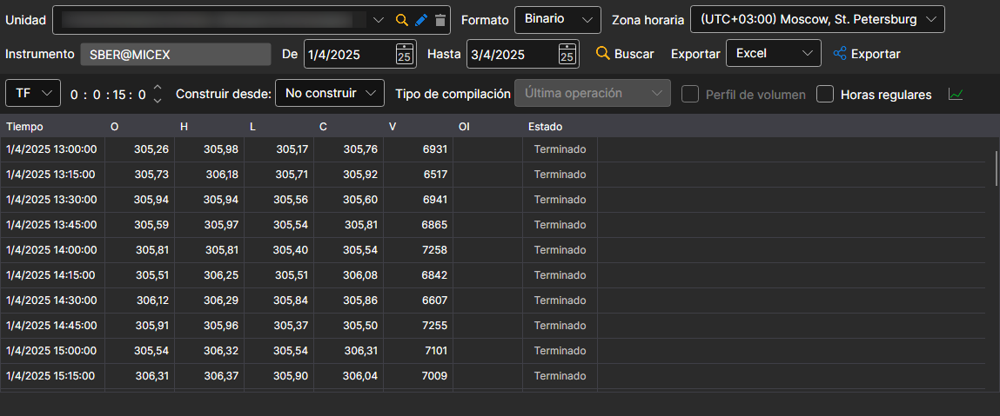

# Convertidor

La tarea convierte datos bursátiles. Por ejemplo, de registros de órdenes a ticks o de ticks a velas, etc.

La tarea se añade con el botón **Herramientas**: en la ventana que se abre, hay que marcar el elemento **Convertidor** y pulsar el botón **Agregar seleccionados**. La configuración de la tarea está dividida en pestañas, y el enlace **Configuraciones avanzadas** la muestra entera en una sola lista.

**Convertidor**

- **Origen** - qué tipo de datos se convertirá.
- **Formato** - formato de los datos convertidos: BIN\/CSV.
- **Desfase temporal** - desplazamiento de tiempo en días desde la fecha en que se inició la tarea. Esto evita convertir un día incompleto. Si está configurada la conversión de datos en tiempo real, el intervalo de actualización puede dejar el día actual solo parcialmente convertido. Use el desplazamiento de tiempo para evitarlo.
- **Destino** - directorio de datos donde se guardarán los datos convertidos.

**Vela de marco temporal**

- **Marco temporal** - marco temporal de las velas a partir de las cuales se realiza la conversión, si en el campo **Origen** se han seleccionado velas.

**Libros de órdenes**

- **Intervalo** - intervalo de generación del libro de órdenes.
- **Profundidad** - profundidad máxima de generación del libro de órdenes.
- **Registro de órdenes** - cómo construir libros de órdenes a partir del registro de órdenes.

  **Predeterminado** sirve en la mayoría de los casos. Si la conexión tiene su propio formato de registro de órdenes (por ejemplo, **Plaza** en la Bolsa de Moscú), ese formato aparece en la lista cuando la conexión está establecida.

**General**

- **Continuar** - continuar la conversión desde la última fecha convertida.
- **Intervalo de operación** - intervalo de operación.
- **Directorio de datos** - directorio de datos desde el que se recibirán los datos para la conversión.
- **Formato** - formato de los datos que se convierten: BIN\/CSV.
- **Máx. errores** - número máximo de errores tras el cual la tarea se detendrá. De forma predeterminada, 0: se ignora el número de errores.
- **Encabezado** - Convertidor.
- **Horario de trabajo** - horario de trabajo de la tarea. 

**Registro**

- **Nivel de registro** - nivel de registro.

Consideremos un ejemplo de conversión de datos.

1. Vaya a la tarea **Convertidor** y añada un instrumento con el botón **+** situado encima de la tabla. 
2. En la ventana que aparece, establezca el tipo de datos que debemos recibir durante la conversión y el período. El tipo de datos desde el que se realiza la conversión se define en la opción **Origen**. Por ejemplo, necesita convertir Ticks en velas con marco temporal de 15 minutos.

   > [!TIP]
> ¡IMPORTANTE\! El período de datos solicitado debe coincidir con el período disponible para la conversión; de lo contrario, los datos no se convertirán. En la configuración, especifique el formato correcto de datos de origen para que coincida con el formato de los datos convertidos.
3. Especifique los directorios necesarios. Desplazamiento de tiempo. Intervalo de operación.
4. Habilite la tarea con el interruptor **Habilitado** e inicie la conversión con el botón **Inicio**. 

Se puede ver que los datos se han convertido. [Revisemos](../working_with_data/view_and_export.md) los datos resultantes.

Esta función es similar a [obtener los datos de mercado necesarios](../working_with_data/any_market_data_types.md) desde otro tipo de datos.

**Ver [tutorial en video](../videos/converter_task.md)**
