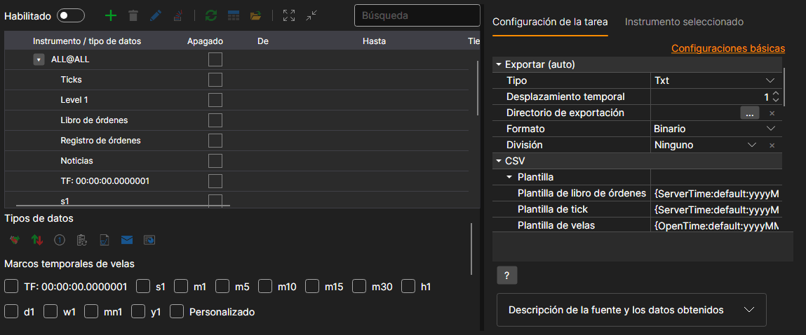
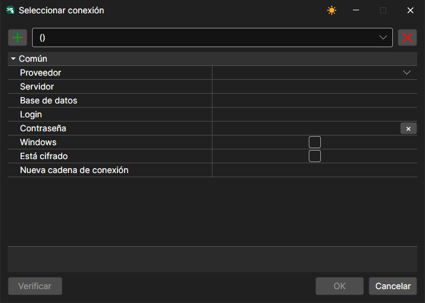
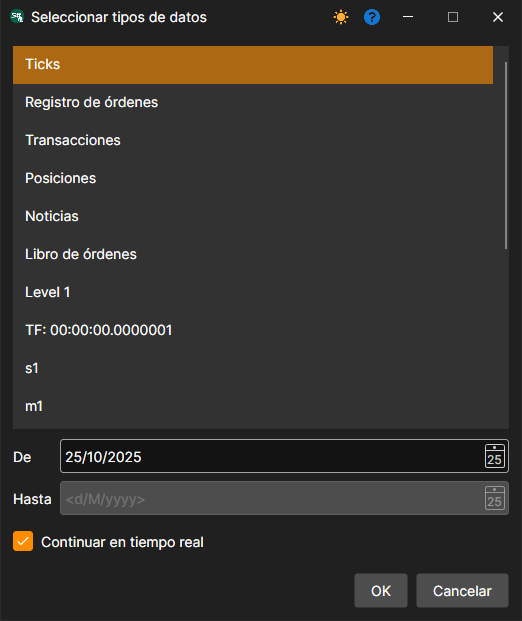
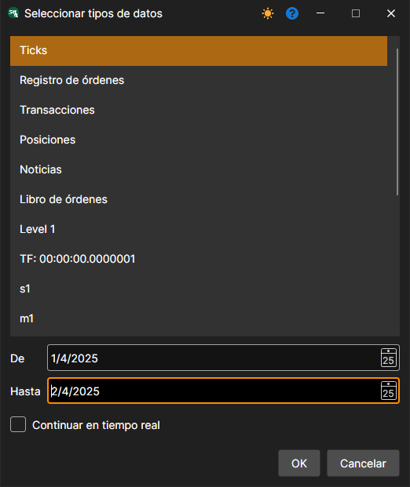
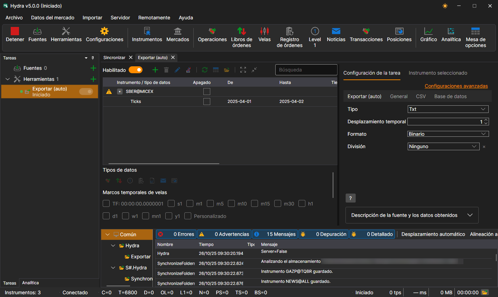

# Exportación automática

La tarea exporta datos bursátiles a varios formatos: Excel, xml, sql, bin, Json o txt.

La tarea se añade con el botón **Herramientas**: en la ventana que se abre, hay que marcar el elemento **Exportar (auto)** y pulsar el botón **Agregar seleccionados**. La configuración de la tarea está dividida en pestañas, y el enlace **Configuraciones avanzadas** la muestra entera en una sola lista.



**Exportación (automática)**

- **Tipo** - tipo de exportación (formato).
- **Desfase temporal** - desplazamiento de tiempo en días.
- **Directorio de exportación** - directorio donde se exportarán los datos. Si no se especifica, los archivos se guardan en el directorio de datos.
- **Formato** - formato de datos.
- **División** - tipo de división: por días, meses o años.

**Base de datos**

- **Conexión** - conexión a la base de datos. Se usa en caso de exportación mediante SQL.
- **Paquete** - tamaño del paquete de datos transmitido. De forma predeterminada, el tamaño es de 50 elementos. Se usa en caso de exportación mediante SQL.
- **Unicidad** - comprobar la unicidad de los datos en la base de datos. Afecta al rendimiento. Está habilitado de forma predeterminada. Se usa en caso de exportación mediante SQL.

> [!TIP]
> Al usar exportación mediante SQL, hay que definir la conexión a la base de datos.

La ventana de conexión se abre con el botón de la lupa del campo **Conexión**, y en ella el botón **+** añade una nueva conexión:



- **Proveedor** - configuración del proveedor.
- **Servidor** - dirección del servidor o ruta a la base de datos.
- **Base de datos** - nombre de la base de datos. No se usa para SQLite.
- **Inicio de sesión** - inicio de sesión para acceder a la base de datos. No se usa para acceso anónimo.
- **Contraseña** - contraseña para acceder a la base de datos. No se usa para acceso anónimo.
- **Windows** - usar la cuenta actual de Windows para conectarse a la base de datos.
- **Está cifrado** - cifrar la conexión con el servidor.
- **Nueva cadena de conexión** - cadena de conexión preparada.

> [!TIP]
> Puede comprobar la conexión a la base de datos con el botón **Comprobar**.

**CSV**

- **Plantilla** - plantillas para cada tipo de datos exportados.
- **Encabezado** - encabezado en la primera línea. Si se pasa una cadena vacía, el encabezado no se añadirá al archivo.
- **Formato del nombre del archivo** - formato para escribir el nombre del archivo exportado.

**General**

- **Continuar** - continuar la exportación desde la última fecha exportada.
- **Intervalo de operación** - intervalo de operación.
- **Directorio de datos** - directorio de datos del que se toman los datos exportados.
- **Formato** - formato de los datos convertidos: BIN\/CSV.
- **Máx. errores** - número máximo de errores tras el cual la tarea se detendrá. De forma predeterminada, 0: se ignora el número de errores.
- **Encabezado** - título de la tarea.
- **Horario de trabajo** - horario de trabajo de la tarea. 

**Registro**

- **Nivel de registro** - nivel de registro.

Consideremos un ejemplo de exportación automática:

1. Seleccione el instrumento con el botón **+** situado encima de la tabla.
2. Configure los datos de mercado que deben exportarse.
3. Establezca el período de exportación. Si está configurada la descarga de datos de mercado en tiempo real, puede omitir la fecha final del período. En este caso, los datos se exportarán en tiempo real, de acuerdo con el intervalo de trabajo (actualización de datos). 
4. Configure directorios. Intervalo de operación. Tipo de datos. Formato de datos.
5. Habilite la tarea con el interruptor **Habilitado** e inicie la exportación con el botón **Inicio**.

Veamos los datos exportados. Los ticks de SBER@MICEX del 1 y el 2 de abril, exportados al tipo **Txt** con la plantilla de ticks predeterminada, están en el archivo `trades_SBER@MICEX_2025_04_01_2025_04_02.csv` y empiezan así:

```
20250401;10:00:00.000000;15500000;305.26;88;Buy
20250401;10:00:09.000000;15500001;305.23;2;Sell
20250401;10:00:18.000000;15500002;305.20;48;Sell
20250401;10:00:27.000000;15500003;305.22;46;Buy
20250401;10:00:36.000000;15500004;305.28;105;Sell
```

**Ver [tutorial en video](../videos/export_task.md)**
