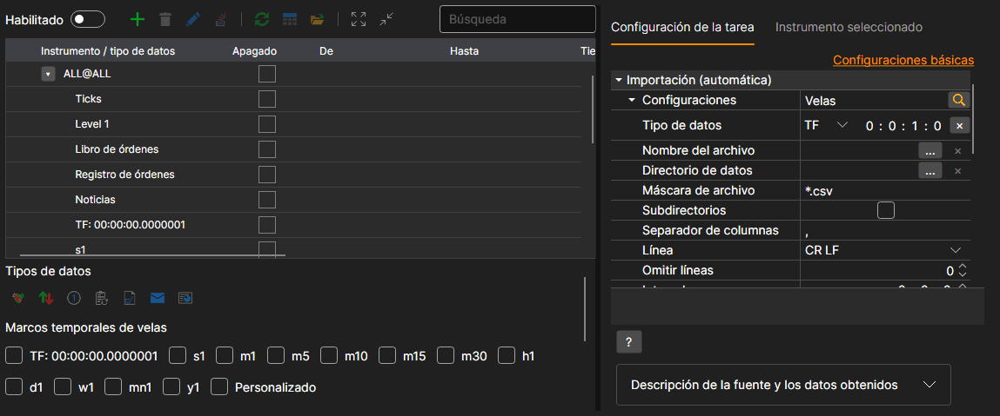
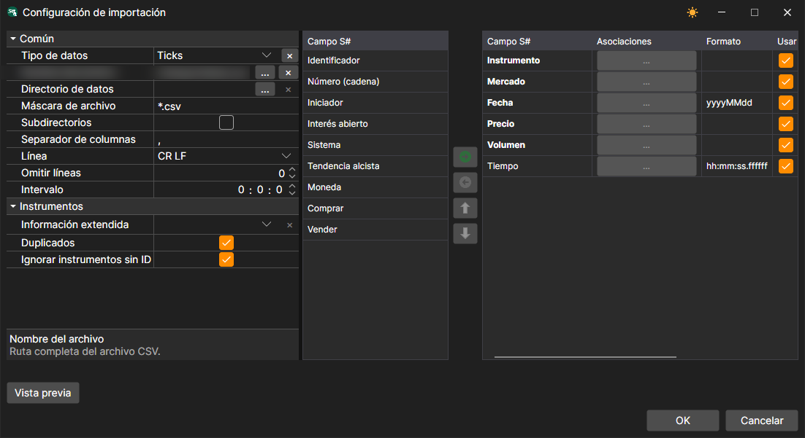
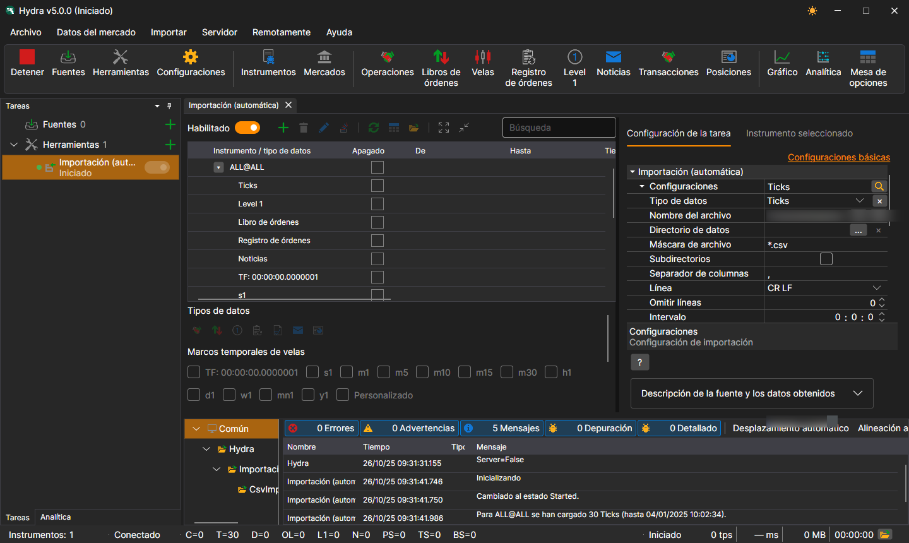

# Importación automática

La tarea realiza la importación automática de datos bursátiles desde archivos del directorio especificado de acuerdo con la máscara de archivo especificada.

La tarea se añade con el botón **Herramientas**: en la ventana que se abre, hay que marcar el elemento **Importación (automática)** y pulsar el botón **Agregar seleccionados**. El enlace **Configuraciones avanzadas** muestra toda la configuración de la tarea en una sola lista.

Qué importar y desde dónde se define en la línea **Configuración**. El botón de la lupa de esta línea abre una ventana en la que, además de esa misma configuración, las columnas del archivo se asocian con los campos de S#, igual que en la pestaña [Importación](../importing.md):

**Configuración**

- **Tipo de datos** - tipo de datos importados.
- **Nombre de archivo** - ruta completa al archivo.
- **Directorio de datos** - directorio con los archivos, si no se importa un solo archivo, sino todos los archivos adecuados del directorio.
- **Máscara de archivo** - máscara de archivo que se usa al escanear el directorio. Por ejemplo, candles\*.csv.
- **Subdirectorios** - incluir subdirectorios.
- **Separador de columnas** - separador de columnas. La tabulación se indica como TAB.
- **Línea** - final de línea en el archivo: CR LF, LF o CR.
- **Omitir líneas** - número de líneas que se omitirán desde el inicio del archivo (si contienen metainformación).
- **Intervalo** - frecuencia de actualización de datos.
- **Información extendida** - guardar los campos importados extendidos en el almacenamiento de información extendida.
- **Duplicados** - indica si los instrumentos duplicados deben actualizarse si ya existen.
- **Ignorar sin ID** - ignorar instrumentos sin identificador.

**General**

- **Continuar** - continuar la importación desde la última fecha importada.
- **Intervalo de operación** - intervalo de operación.
- **Directorio de datos** - directorio de datos desde el que se recibirán los datos para la conversión.
- **Formato** - formato de los datos convertidos: BIN\/CSV.
- **Máx. errores** - número máximo de errores tras el cual la tarea se detendrá. De forma predeterminada, 0: se ignora el número de errores.
- **Encabezado** - título de la tarea.
- **Horario de trabajo** - horario de trabajo de la tarea. 

**Registro**

- **Nivel de registro** - nivel de registro.

Consideremos un ejemplo de importación automática de ticks. En el archivo `ticks.csv`, cada operación está escrita en una línea del tipo `GAZP,TQBR,20250401,128.58,74,10:00:02.000000`: instrumento, mercado, fecha, precio, volumen y hora.

1. Con el botón de la lupa de la línea **Configuración** abrimos la ventana de configuración de la importación.
2. Seleccionamos el tipo de datos **Ticks** e indicamos la ruta al archivo en el campo **Nombre de archivo**.
3. Añadimos a los campos de S# el campo **Tiempo**: los campos obligatorios (instrumento, mercado, fecha, precio y volumen) ya están en el orden en que van las columnas en el archivo, y la hora se añade a continuación. Pulsamos **OK**.
4. Habilitamos la tarea con el interruptor **Habilitado** e iniciamos la importación con el botón **Inicio**. 
