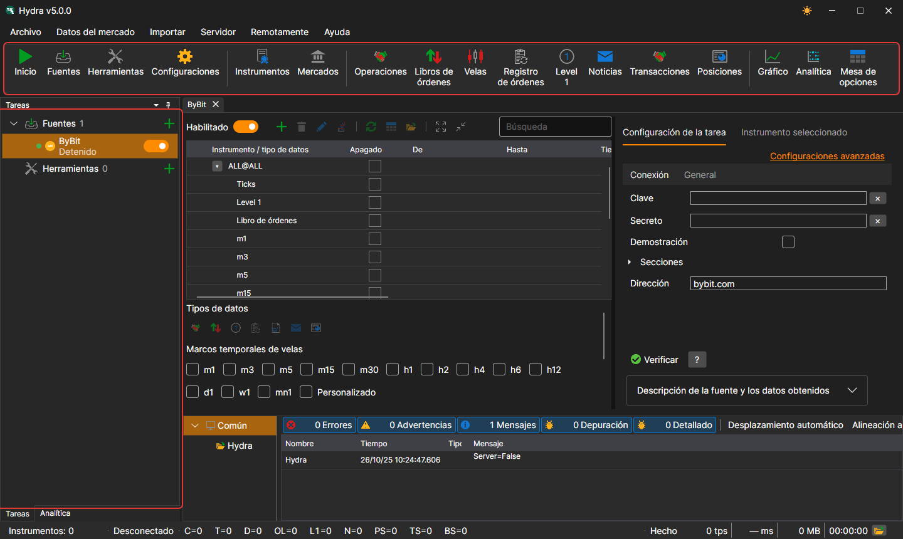
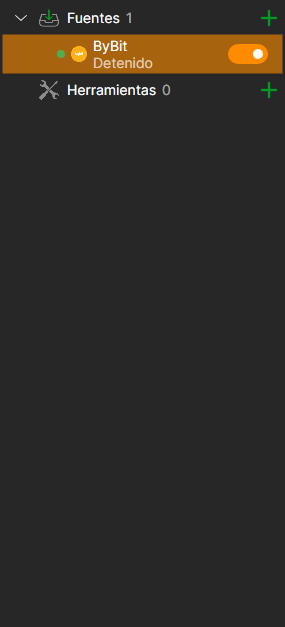
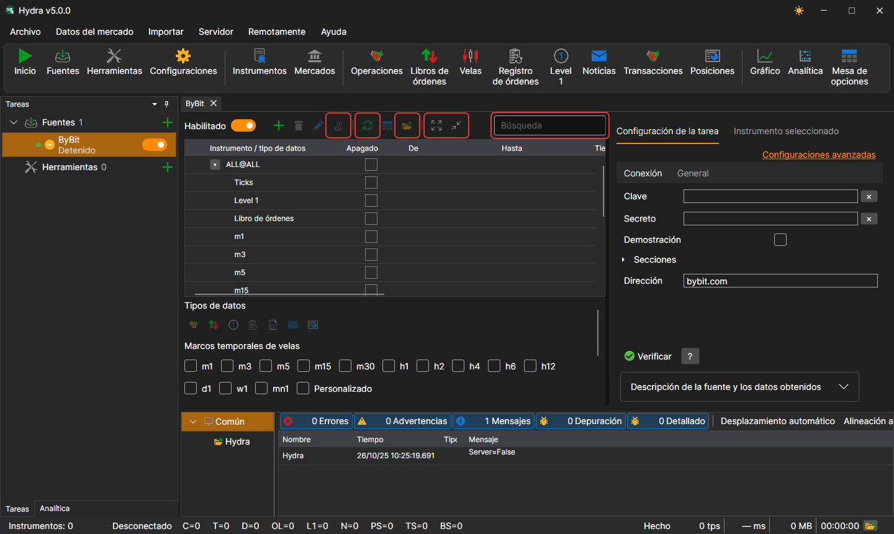

# Interfaz del programa

La ventana de [Hydra](../hydra.md) consta del menú, la barra de comandos situada debajo, los paneles **Tareas** y **Analítica** a la izquierda, el panel **Registros** abajo y los documentos en el centro: paneles de fuentes, de herramientas y de datos de mercado. En la parte inferior de la ventana está la barra de estado.

## Menú

- **Archivo** — adición de [fuentes](data_sources.md) y herramientas, [configuración general](misc/settings.md), [configuración del proxy](misc/network_settings.md), [restablecimiento de la configuración](misc/settings_reset.md) y salida.
- **Datos del mercado** — paneles para ver los datos de mercado del almacenamiento: instrumentos, mercados, operaciones, libros de órdenes, velas, registro de órdenes, Level 1, noticias, transacciones, posiciones, así como el [gráfico](working_with_data/chart.md), la analítica y la mesa de opciones.
- **Importar** — [importación](importing.md) de datos desde archivos, [sincronización](misc/synchronization.md) del almacenamiento y construcción de su índice.
- **Servidor** — [modo servidor](server_mode/settings.md): activación, configuración de red, usuarios y suscripciones de los clientes.
- **Remotamente** — control remoto de Hydra mediante el bot de Telegram ([Panel de control](../telegram_services/control_panel.md)) y la ventana **Canales** con la lista de canales de Telegram a los que Hydra envía mensajes.
- **Ayuda** — cambio del tema, contacto con el equipo de StockSharp, informe de un problema, documentación y la ventana **Acerca del programa**.

En macOS, el menú pasa a la barra de menús del sistema.

## Barra de comandos

Debajo del menú está la barra de comandos con las acciones más frecuentes: **Iniciar / detener todas las tareas**, adición de fuentes y herramientas, configuración; los paneles **Instrumentos** y **Mercados**; los paneles de datos de mercado (operaciones, libros de órdenes, velas, registro de órdenes, Level 1, noticias, transacciones y posiciones); **Gráfico**, **Analítica** y **Mesa de opciones**.

## Tareas

En el panel **Tareas** de la izquierda, las tareas están organizadas en los grupos **Fuentes** y **Herramientas**. Cada grupo muestra el número de tareas y un botón **+** que añade una nueva. Cada tarea tiene un punto (verde si la tarea está habilitada), un icono, el nombre, una línea con su estado actual y un interruptor; el icono del reloj indica que la tarea tiene definido un horario de trabajo. Un doble clic abre el panel de la tarea, y un clic derecho, un menú con las opciones **Abrir** y **Eliminar**.

Mientras no hay nada abierto en el centro de la ventana, allí se muestra la pantalla de bienvenida con los botones **Añadir fuentes** y **Añadir herramientas**.

Mientras dura un trabajo largo, por ejemplo, la lectura de un almacenamiento grande o la adición de una fuente, la ventana queda cubierta por una capa semitransparente con la descripción de lo que se está haciendo.

## Panel de la tarea

Encima de la tabla de instrumentos de la fuente están la búsqueda, el interruptor **Habilitado**, los botones para añadir, eliminar y modificar instrumentos, **Agregar ALL@** (todos los instrumentos de la fuente a la vez), la sincronización de fechas, el paso a los datos y a la carpeta del almacenamiento, y contraer y expandir las filas. En la pestaña de configuración hay un botón para comprobar la conexión y la descripción de la fuente, y en la pestaña **Instrumento seleccionado**, las propiedades del instrumento seleccionado en la tabla.

## Barra de estado

En la parte inferior de la ventana se ve cuántos instrumentos hay en el almacenamiento, si Hydra está conectada, cuántos datos de cada tipo se han recibido desde el inicio, en qué está ocupado el programa ahora y la última advertencia o el último error del registro. El botón de la carpeta abre la carpeta de registros. Mientras dura una operación larga (la lectura de un almacenamiento grande, la adición de una fuente), la ventana queda cubierta por una capa con la descripción del trabajo.

## Véase también

[Primer inicio](first_start.md)

[Fuentes de datos](data_sources.md)
