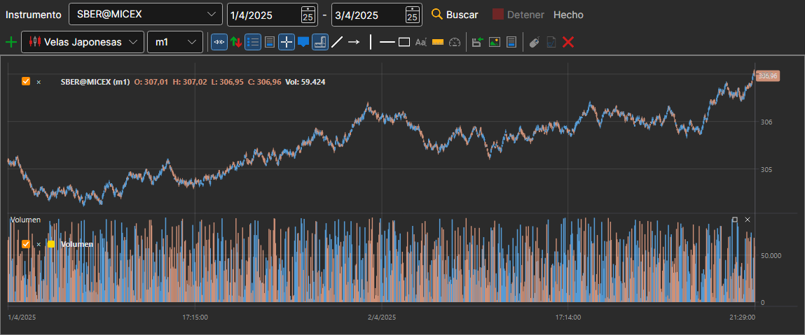

# Gráfico

El panel **Gráfico** muestra las velas de cualquier instrumento que haya en el almacenamiento. Se abre con la opción **Datos del mercado → Gráfico** o con el botón **Gráfico** de la barra de comandos.

En la línea situada encima del gráfico se eligen el **Instrumento** y el período (la fecha de inicio y la de fin) y después se pulsa **Buscar**. Las velas se leen del almacenamiento y se dibujan a medida que se leen; **Detener** interrumpe la lectura, y la línea junto a los botones muestra cómo avanza el trabajo.

Debajo hay un gráfico completo, igual que en [Terminal](../../terminal/user_interface/components/chart.md): con barra de botones, estilos de velas, indicadores y dibujo. Al gráfico se le puede añadir un [indicador](view_and_export/indicators.md), y el botón **Detener dibujo** detiene el dibujo prolongado de un período grande.

## Véase también

[Generación de velas](candles_generation.md)

[Ver datos de mercado](view_and_export.md)
