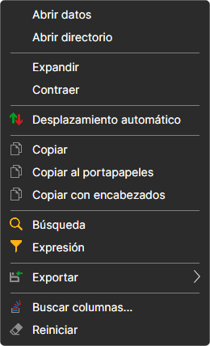
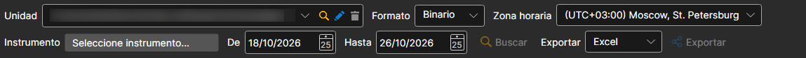
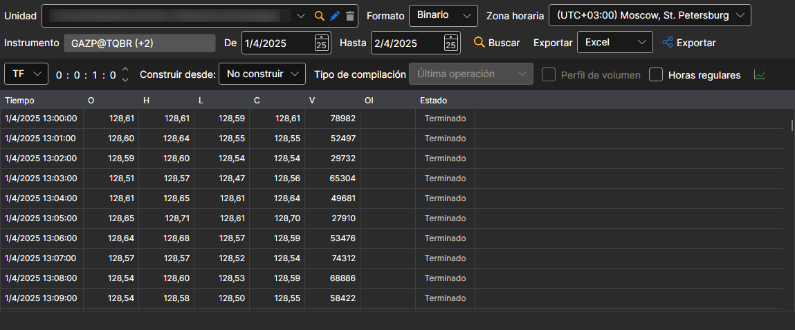
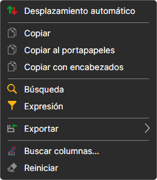

# Ver y exportar

Los datos recibidos por [Hydra](../../hydra.md) se pueden ver en paneles especiales.

Para ello, en el menú **Datos del mercado** seleccione una de las siguientes opciones: [Ticks](view_and_export/ticks.md), [Libros de órdenes](view_and_export/order_books.md), [Generación de velas](candles_generation.md), [Registro de órdenes](view_and_export/order_log.md), [Level 1](view_and_export/level_1_.md), [Noticias](view_and_export/news.md), [Transacciones](view_and_export/transactions.md), [Panel de opciones](view_and_export/option_desk.md), [Indicadores](view_and_export/indicators.md), [Posiciones](view_and_export/positions.md).

El panel con los datos de una tarea también se abre desde su tabla de instrumentos: con un doble clic en el tipo de datos o con la opción **Abrir datos** del menú contextual, como se muestra en la figura.

Cada panel contiene una interfaz general de configuración como la siguiente:

- En la línea superior se indican el almacenamiento de datos de mercado (**Unidad**), su **Formato** (binario o CSV) y la **Zona horaria** en la que se muestra la hora.
- En la segunda línea se eligen los instrumentos y el período para el que se solicitarán los datos. Al hacer clic en el botón **Seleccionar instrumento**, aparecerá la ventana de selección de instrumentos, donde puede seleccionar uno o varios instrumentos. Si se seleccionan varios instrumentos, durante la exportación posterior a Excel o CSV el programa ordenará automáticamente los datos de distintos instrumentos en archivos diferentes.
- Los datos encontrados se cargan en la tabla por partes de mil filas: la siguiente parte se carga sola cuando la tabla se desplaza hasta el final, por lo que se puede avanzar todo lo que se quiera sin esperar a que se cargue todo el período. La ordenación por columna ordena las filas ya cargadas, y la exportación con los botones del panel escribe todos los datos del período seleccionado, no solo los cargados.
- Si los datos se recibieron de fuentes cuya zona horaria no coincide con la zona horaria actual, puede ajustar la zona horaria. Después de construir, los datos se mostrarán en la zona seleccionada por el usuario. 
- Como varias fuentes no ofrecen la posibilidad de descargar algunos datos, el programa proporciona el campo [Construir a partir de](any_market_data_types.md). Con este campo, el usuario puede construir datos de mercado a partir de otro tipo de datos de mercado. La misma función puede usarse para construir datos de mercado sin descarga adicional, usando como base datos ya existentes.
- Después de seleccionar los parámetros anteriores, debe hacer clic en el botón **Buscar** . Mientras dura la búsqueda o la exportación, debajo de las líneas de configuración se muestra su progreso y el botón **Detener**. Cuando termina la exportación, allí mismo aparece el botón **Abrir archivo** o **Abrir carpeta** con su resultado.

El menú contextual de la tabla de valores permite activar el desplazamiento automático, copiar las filas seleccionadas al portapapeles, buscar un valor, filtrar las filas con una expresión, exportar la tabla a un archivo, al portapapeles o a la impresora, elegir las columnas que se muestran y restablecer su disposición.

