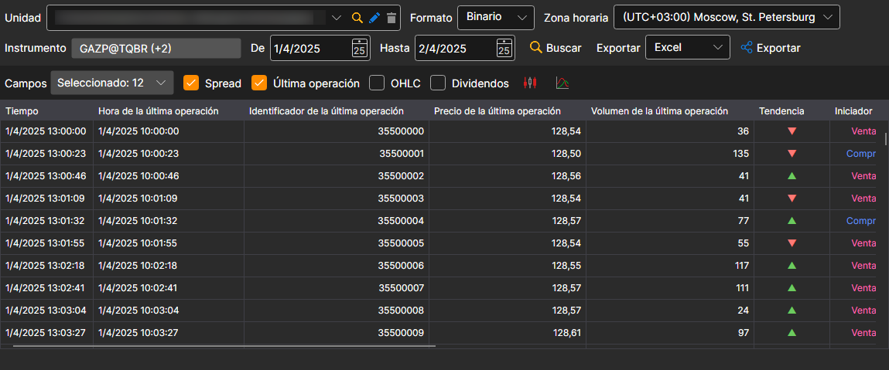
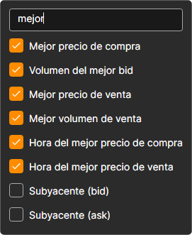

# Level 1

En la ventana que aparece, seleccione los instrumentos, el intervalo de tiempo requerido y haga clic en el botón :

La lista **Campos** define qué valores de Level 1 se muestran en la tabla y se incluyen en la exportación. Marque los campos necesarios en la lista desplegable; la línea de búsqueda de la parte superior de la lista deja solo los campos cuyo nombre contiene el texto escrito:

Los valores recibidos se pueden [exportar al formato requerido](../export_data.md).
