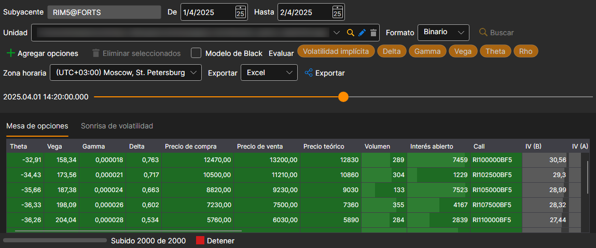
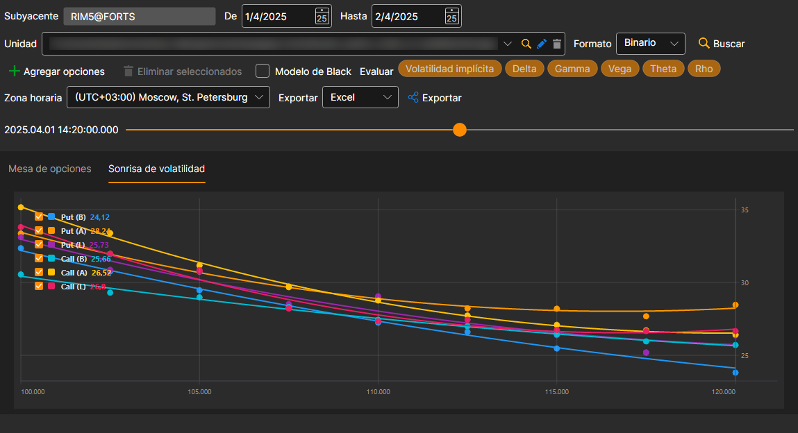

# Panel de opciones

En la ventana que aparece, seleccione el activo subyacente: sus opciones se añadirán solas al panel, y el rango de tiempo se ajustará al período para el que hay datos en el almacenamiento. Con el botón **Agregar opciones** puede añadir otras opciones y con el botón **Eliminar seleccionados**, quitar las que sobran. Después haga clic en el botón :

Si no hay historial de las griegas, pero hay datos sobre el spread, se pueden calcular las principales griegas (Delta, Gamma, Vega, Theta, Rho, Volatilidad (implícita)): para ello hay que marcarlas en el campo **Evaluar**. La volatilidad se calcula a partir del precio de compra, del de venta y del de la última operación, y las demás griegas, a partir de la volatilidad del punto medio del spread.

El control deslizante situado encima del panel lo lleva a cualquier momento del historial cargado; a la izquierda del control se muestra la hora de ese momento. Cuando el control llega al último momento cargado, se carga la siguiente parte del historial.

Para ver la **Sonrisa de volatilidad**, debe ir a la pestaña **Sonrisa de volatilidad**.

Los valores calculados se pueden [exportar al formato requerido](../export_data.md).
