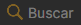
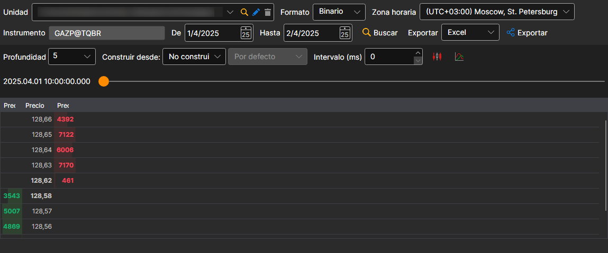

# Libros de órdenes

En la ventana que aparece, seleccione los instrumentos, el intervalo de tiempo requerido y haga clic en el botón :

El control deslizante elige cuál de los libros de órdenes cargados se muestra. Cuando llega al último libro de órdenes cargado, se cargan los siguientes.

> [!TIP]
> Los libros de órdenes se pueden crear a partir de [archivos de registro de órdenes y Level 1](../any_market_data_types.md). Además, puede ajustar la profundidad y el período de actualización del libro de órdenes.

Los valores recibidos se pueden [exportar al formato requerido](../export_data.md).
