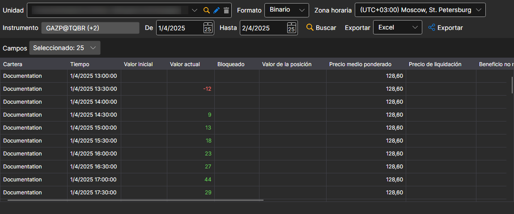

# Posiciones

En la ventana que aparece, seleccione los instrumentos, el intervalo de tiempo requerido y haga clic en el botón :

La lista **Campos** define qué valores de la posición se muestran en la tabla y se incluyen en la exportación.

Los valores recibidos se pueden [exportar al formato requerido](../export_data.md).
