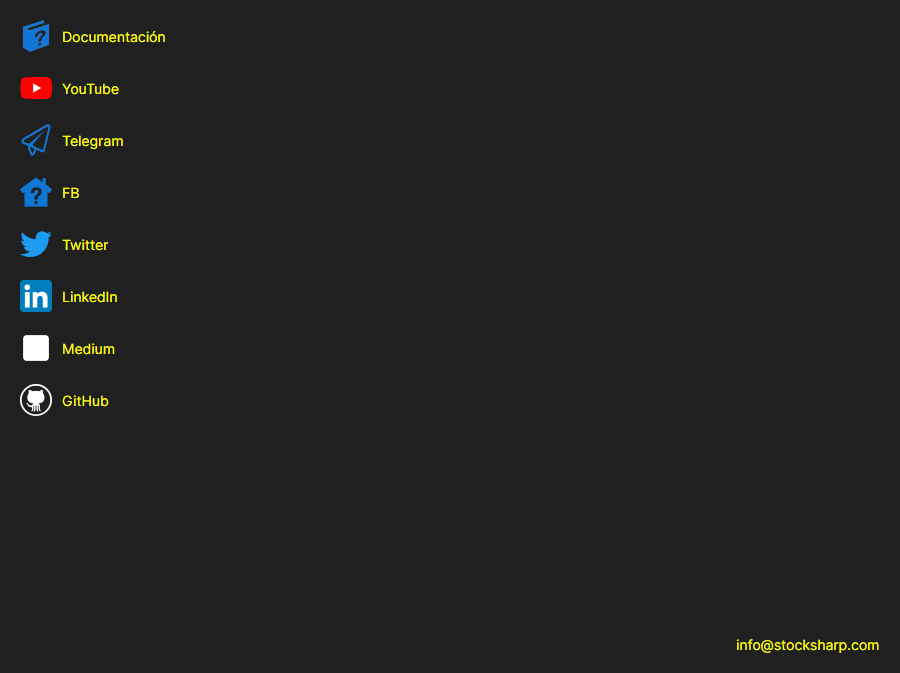

# Ayuda

La página **Ayuda** se abre con la pestaña del mismo nombre de la parte superior de la ventana de [Installer](../installer.md).

La página reúne los enlaces que más se buscan desde [Installer](../installer.md): **Documentación**, **YouTube**, **Telegram** (chat de soporte), **Twitter**, **Dzen** y **GitHub**. El enlace se abre en el navegador predeterminado del sistema. En la parte inferior de la página está la dirección de correo a la que se puede escribir a la empresa.

Se puede informar de un problema con el botón del título de la ventana, que está en cualquier página. Si [Installer](../installer.md) no se ha comportado como se esperaba, adjunte al mensaje las entradas de la página [Registros](logs.md): en ellas se ve qué ha ocurrido exactamente.

## Véase también

[Registros](logs.md)
