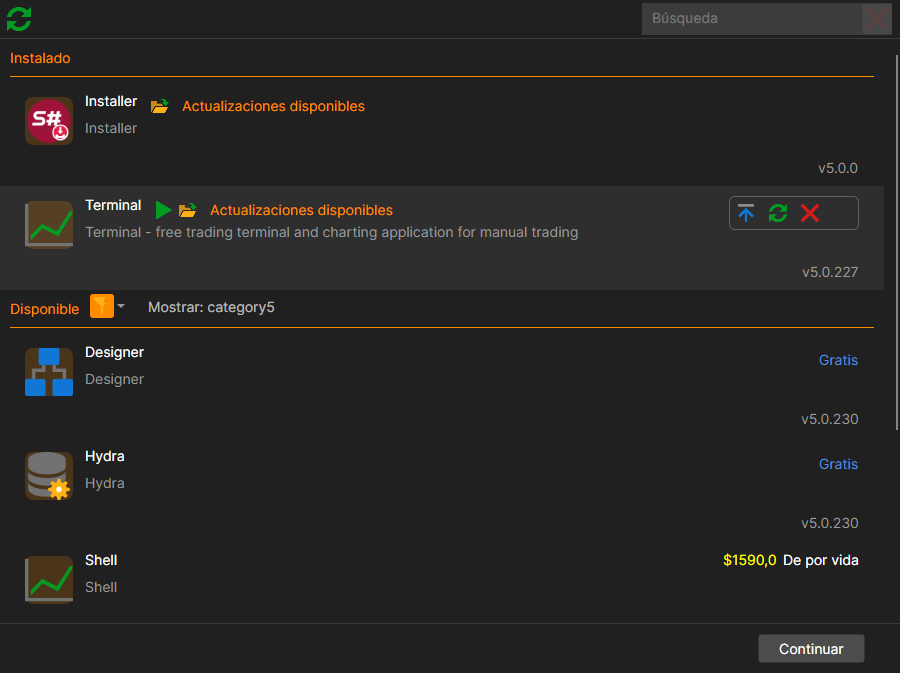
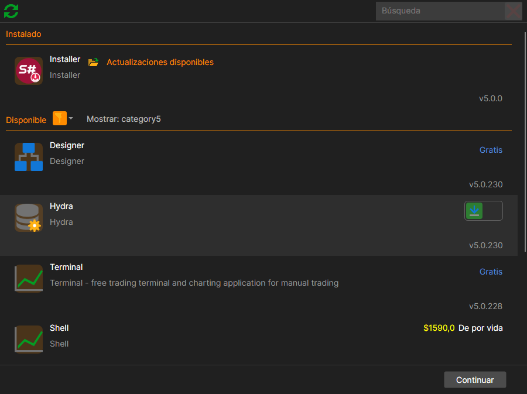
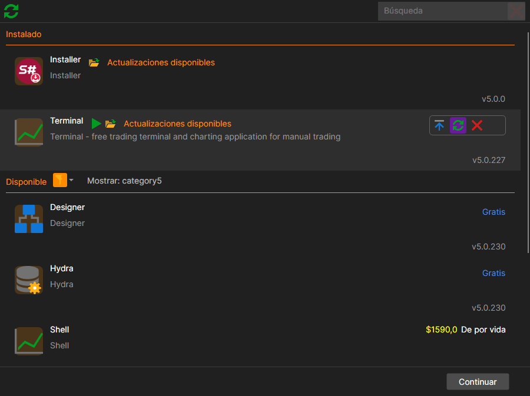
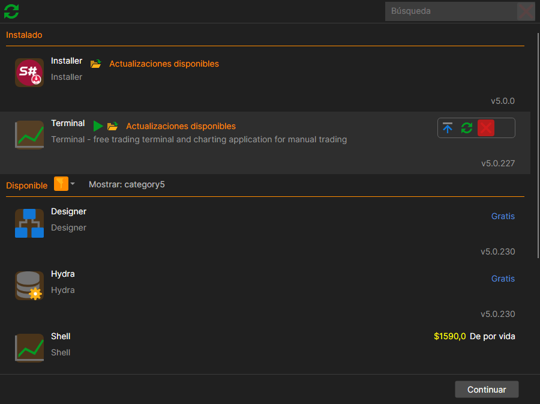
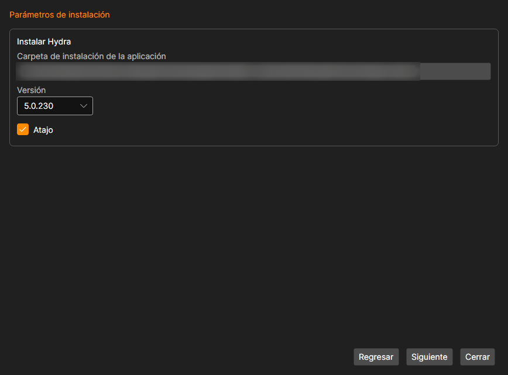

# Instalar y eliminar aplicaciones

Todo lo que [Installer](../installer.md) hace con los programas se hace en la pestaña **Aplicaciones**: la instalación, la actualización, la reparación y la eliminación. La acción se marca en el producto de la lista, y todas las marcadas se ejecutan a la vez.

## Catálogo

La lista está dividida en dos partes: **Instalado**, lo que ya está en este equipo, y **Disponible**, lo que se puede instalar. Si una parte no contiene nada, en su lugar aparece **Vacío**.

Para encontrar lo que necesita, sirven:

- el campo **Búsqueda** situado encima de la lista: la lista se reduce a medida que se escribe, y la cruz de al lado la restablece entera;
- el embudo junto al título **Disponible**: filtro por tipo de producto; el botón **Todo** lo quita;
- el botón con la flecha circular de la esquina superior izquierda, **Verificación forzada de actualizaciones**: pregunta a la tienda si ha salido algo nuevo, sin esperar a la siguiente comprobación.

En la fila de un producto instalado se muestra su versión y, si ha salido una nueva, el texto **Actualizaciones disponibles**.

## Contrato de licencia

En la parte inferior de la ventana hay una casilla de aceptación con un enlace al texto del contrato. Mientras no se acepte, el botón **Continuar** sigue sin estar disponible, se marque lo que se marque. La aceptación se da una sola vez y se registra en el servidor: después la casilla ya no se muestra y no se puede retirar.

## Qué hacer con el producto

A la derecha de cada fila hay un conjunto de botones, de los que se elige uno. Cuáles hay depende del producto:

| Botón | Cuándo está disponible | Qué hace |
|---|---|---|
| **Instalar** | el producto no está instalado | lo instala |
| **Actualizar** | está instalado y ha salido una nueva versión | lo actualiza |
| **Reparar** | está instalado | lo vuelve a instalar encima, sin tocar la configuración |
| **Eliminar** | está instalado | lo elimina |
| **Omitir** | siempre | no hacer nada con este producto |

Un producto no instalado tiene una sola opción, instalarlo:

Uno instalado, la reparación:

y la eliminación:

El botón **Continuar** de la esquina inferior derecha se activa en cuanto se marca al menos una acción. Se pueden marcar varios productos a la vez, por ejemplo, actualizar uno y eliminar otro. Cuando todo esté marcado, pulse **Continuar** en la esquina inferior derecha.

## Asistente

A continuación, en lugar de la lista, la ventana muestra un asistente de tres pasos.

1. **Aplicaciones**: qué se va a hacer exactamente. Revise la lista y pulse **Continuar**.
2. **Parámetros de instalación** 

   Cada acción tiene aquí su propia configuración:

   - **Carpeta de instalación de la aplicación**: se elige con un botón. **¡IMPORTANTE\!** La carpeta debe estar vacía.
   - **Versión** y **Destinatario**: qué versión se instala y para quién.
   - **Atajo**: crear un acceso directo en el escritorio.
   - **Elimine la carpeta de datos de la aplicación**: solo al eliminar; borrar junto con el programa su configuración y los datos descargados. Sin esta casilla, se conservan.
   - **Complementos**: para los programas que los admiten, qué conectores instalar junto con el producto.
   - **Instalar parámetros principales de la aplicación**: en un producto con complementos se puede desmarcar esta casilla y trabajar solo con los complementos, sin tocar el programa en sí.

   Pulse **Siguiente**.
3. **Se realizarán las siguientes acciones**: la última comprobación. Pulse **Ejecutar**.

Mientras dura el trabajo, se muestra **Por favor, espere...**; al terminar, **Hecho**. El botón **Cerrar** vuelve a la lista; **Regresar**, en cualquier paso, lleva al anterior.

Si algo sale mal, el texto del error se muestra directamente en el asistente, y los detalles, en la página [Registros](logs.md).

**Ver [tutorial en video](videos/install_and_remove_apps.md)**

## Contenido recomendado

[Actualizar aplicaciones](update_apps.md)

[Registros](logs.md)
