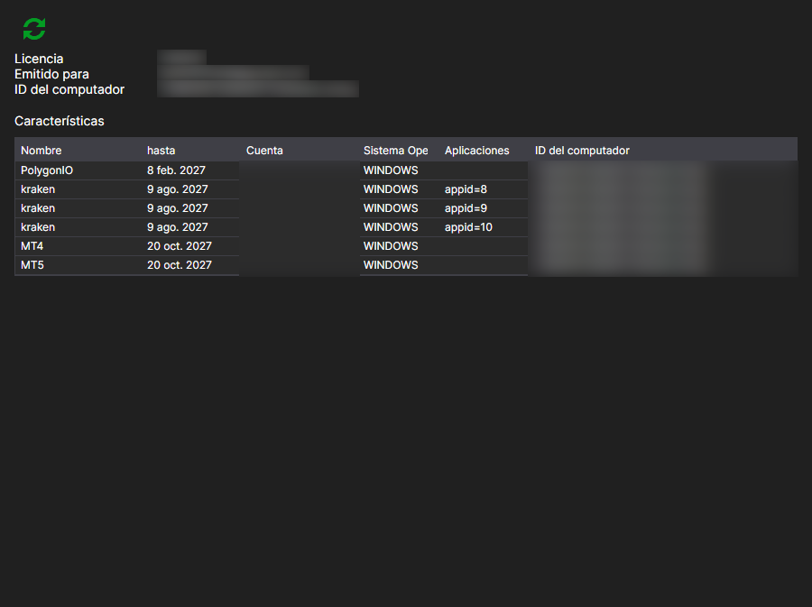

# Licencias

La página **Licencias** se abre con la pestaña del mismo nombre de la parte superior de la ventana de [Installer](../installer.md) y está disponible después de iniciar sesión en la cuenta.

Aquí se ve qué licencia se ha emitido para esta cuenta y a qué da derecho.

- **Emitida para**: a nombre de quién está la licencia y a qué equipo está vinculada: **Identificador del disco** y **Sistema operativo**. Con este vínculo, el servidor decide si la licencia es válida en el equipo actual.
- **Válida hasta**: fecha de vencimiento.
- **Productos**: programas a los que se aplica la licencia.
- **Funciones**: qué está permitido exactamente: conexiones a mercados, número de instrumentos, acceso al código fuente, etc.

El botón **Actualizar licencia** vuelve a solicitar los datos al servidor. Tiene sentido pulsarlo después de una compra o una renovación: [Installer](../installer.md) lee la licencia al iniciar sesión, y un cambio hecho más tarde en el sitio web no aparecerá por sí solo en la ventana.

Si no hay licencia, la página lo indica. Se puede obtener en la página [Tarifas](tariffs.md).

## Véase también

[Tarifas](tariffs.md)
