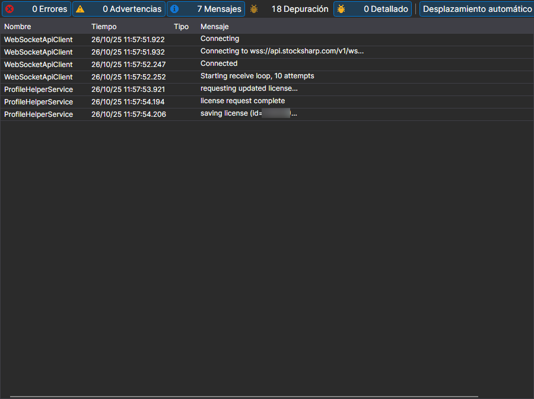

# Registros

La página **Registros** se abre con la pestaña del mismo nombre de la parte superior de la ventana de [Installer](../installer.md).

Aquí [Installer](../installer.md) escribe lo que ha hecho: a qué servidor se ha dirigido, qué paquetes ha descargado, dónde ha instalado y en qué se ha detenido. Es el primer sitio donde mirar si la instalación o la actualización ha terminado con un error.

Cada entrada contiene la hora, el nivel (error, advertencia, mensaje) y el texto. El nivel de detalle del registro se define con el parámetro **Registro** de la página [Configuraciones](settings.md): al contactar con el soporte conviene subirlo y repetir la acción que ha fallado; así en el registro quedará la causa y no solo el hecho del error.

## Véase también

[Configuraciones](settings.md)
