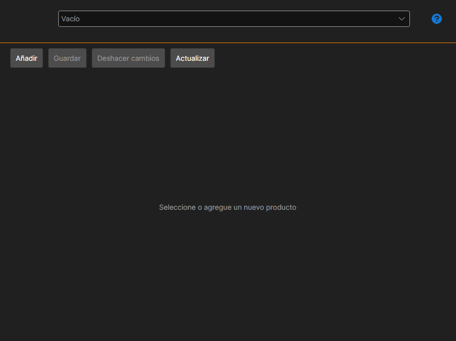

# Mis productos

La página **Mis productos** se abre con la pestaña del mismo nombre de la parte superior de la ventana de [Installer](../installer.md) y está disponible después de iniciar sesión en la cuenta.

La página es para quienes publican sus propios productos en la [tienda](https://stocksharp.com/es/store/): robots, indicadores, conectores. Un comprador no la necesita: la instalación y la actualización se describen en las secciones [Instalar y eliminar aplicaciones](install_and_remove_apps.md) y [Actualizar aplicaciones](update_apps.md).

## Ficha del producto

El producto se elige en la lista de la parte superior; el botón **Añadir** crea uno nuevo.

- **Nombre** y **Descripción**: lo que verá el comprador en la tienda.
- **Identificador de paquete Nuget**: con este nombre se publica el paquete en NuGet. Al lado se muestra cómo será el nombre completo.
- **Tipo de contenido** y **Área**: qué es el producto y dónde se usa.
- **Categorías**: secciones de la tienda en las que se verá el producto.
- **Enlace a la documentación** y **Enlace al código fuente**: opcionales.
- **Icono**: se elige con un botón; es el mismo que ve el comprador en la lista de [Installer](../installer.md).

## Precio

Se define por separado: único (**Permanente**), **Al mes** y **Al año**, más el precio de renovación. Un precio sin rellenar significa que esa forma de compra no existe.

## Acceso

La lista de usuarios define a quién es visible el producto además de la tienda: busque al usuario y añádalo. Así se reparte el acceso, por ejemplo, dentro de un equipo.

## Guardado y publicación

**Guardar** guarda los cambios, **Cancelar cambios** vuelve al último estado guardado y **Actualizar** vuelve a leer la lista desde el servidor.

**Publicar** envía el producto a revisión. Hasta que la supere, la página muestra que el producto todavía no está aprobado, y la lista de errores de la parte inferior enumera lo que hay que rellenar o corregir; mientras no esté vacía, la publicación no se realizará.

## Véase también

[Licencias](licenses.md)
