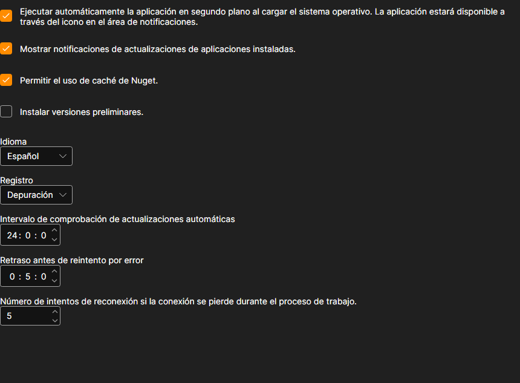

# Configuraciones

La página **Configuraciones** se abre con la pestaña del mismo nombre de la parte superior de la ventana de [Installer](../installer.md).

## Qué se puede cambiar aquí

- **Iniciar automáticamente la aplicación en segundo plano al arrancar el sistema operativo.** [Installer](../installer.md) se inicia con Windows y permanece en el área de notificaciones, desde donde hay que cerrarlo: la cruz de la ventana no apaga el programa.
- **Mostrar notificaciones de actualizaciones de aplicaciones instaladas.** Sin esta casilla, [Installer](../installer.md) sigue comprobando las actualizaciones, pero en silencio: solo se pueden ver en la página de aplicaciones. Para ver cómo es, consulte [Actualizar aplicaciones](update_apps.md).
- **Permitir el uso de caché de Nuget.** Los paquetes ya descargados en este equipo se toman del disco y no de la red. Acelera la reinstalación; se desactiva si hay que descargar el paquete de nuevo con seguridad.
- **Instalar versiones preliminares.** Además de las versiones normales, se ofrecen compilaciones preliminares. Conviene activarlas solo si sabe para qué necesita una versión que todavía no ha salido.
- **Idioma.** El idioma de la interfaz del propio [Installer](../installer.md).
- **Registro.** El nivel de detalle con el que se escribe el registro. Las entradas se ven en la página [Registros](logs.md); al contactar con el soporte, un nivel detallado ayuda a encontrar la causa más rápido.
- **Intervalo de comprobación de actualizaciones automáticas.** Con qué frecuencia [Installer](../installer.md) pregunta al servidor por nuevas versiones, en horas.
- **Retraso antes de reintento por error.** Cuánto esperar antes de repetir una descarga fallida, en minutos.
- **Número de intentos de reconexión si la conexión se pierde durante el proceso de trabajo.** Cuántas veces [Installer](../installer.md) intenta terminar de descargar un paquete antes de informar de un error.

Los cambios se aplican de inmediato y se guardan; no hay un botón aparte para guardar.

## Véase también

[Registros](logs.md)
