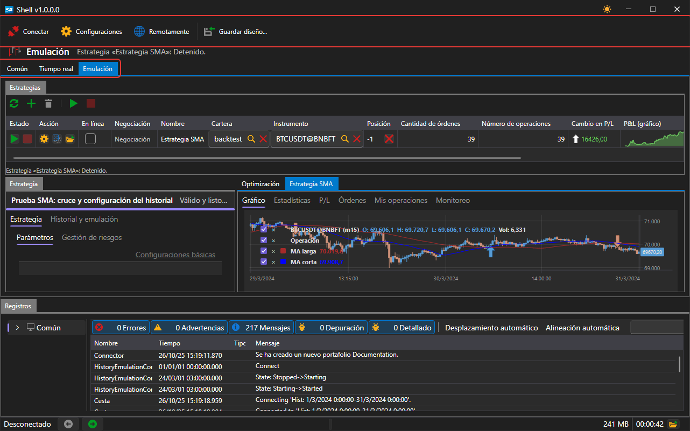
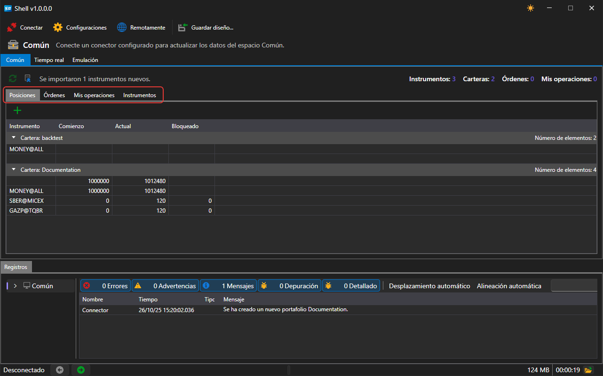
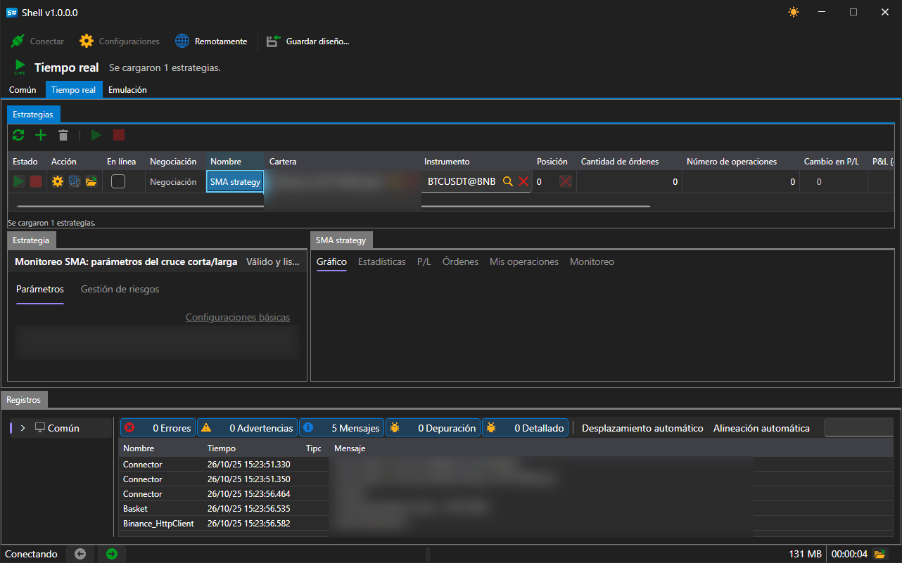
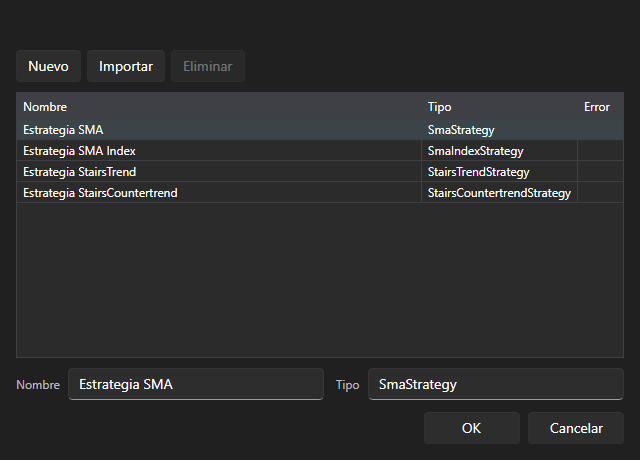
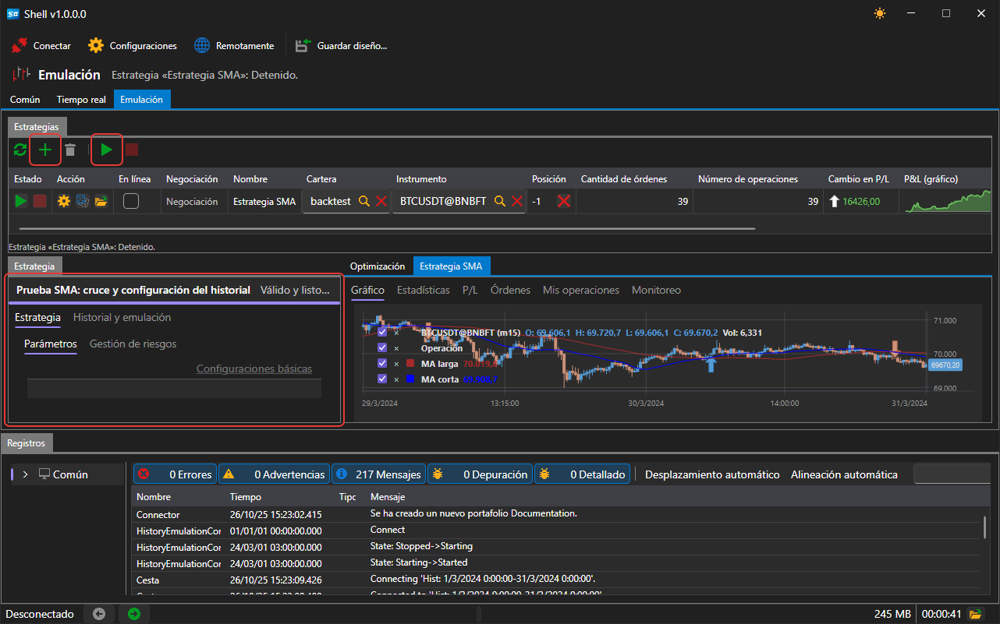

# Inicio rápido

[Shell](../shell.md) es código fuente en [C#](https://en.wikipedia.org/wiki/C_Sharp_(programming_language)) que se abre en Visual Studio, Rider o cualquier otro entorno y se ejecuta como una aplicación normal:

```
dotnet run --project Shell.Avalonia/Shell.Avalonia/Shell.Avalonia.csproj
```

No hace falta ninguna configuración previa: el proyecto se ejecuta tal cual y funciona de inmediato con las estrategias incluidas.

## Ventana principal

Después del inicio se abre una ventana como esta:



A la izquierda está la lista de áreas de trabajo entre las que cambia la aplicación. Arriba está la barra de comandos: el botón de configuración de la conexión, el botón **Conectar** y el guardado de la disposición actual de los paneles. Abajo está la barra de estado con el estado actual de la conexión.

Todo lo que Shell escribe (la configuración de la conexión, la disposición de las ventanas, la lista de estrategias, los esquemas importados de Designer y el almacenamiento local de cotizaciones) está en la carpeta `Data` junto al ejecutable.

## Conexión

Vaya a la configuración de conexión y seleccione el conector necesario. Cómo configurar una conexión se describe en [Configuración de conexiones](connections_settings.md).

Después pulse **Conectar**. El estado de la conexión se muestra en la barra de estado y junto al botón.

Después de conectarse, en la pestaña [Común](user_interface/common.md) aparecerán las carteras, instrumentos, órdenes y operaciones propias recibidos desde la conexión.



## Estrategia en negociación

Vaya a la pestaña [Tiempo real](user_interface/real_time.md).



Pulse **Añadir** y seleccione la estrategia en la ventana que se abre.



La estrategia aparecerá en la tabla **Estrategias** y sus parámetros, en el panel **Estrategia** de la izquierda. Rellene **Instrumento**, **Cartera**, el volumen y los parámetros de la propia estrategia y después pulse **Iniciar**.

Mientras no se haya establecido la conexión, los botones para añadir e iniciar de esta área no están disponibles; lo indica una sugerencia debajo de la tabla.

## Estrategia sobre historial

Lo mismo en la pestaña [Emulación](user_interface/emulation.md) inicia la estrategia sobre datos históricos en lugar de en la negociación.



Para ello no hace falta conexión: cada ejecución lee el historial del disco a través de su propio conector de emulación.

## Contenido recomendado

[Común](user_interface/common.md)

[Tiempo real](user_interface/real_time.md)

[Emulación](user_interface/emulation.md)
