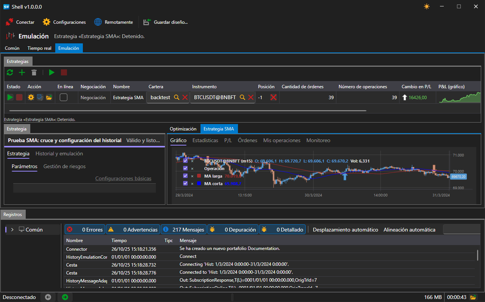

# Control remoto

[Shell](../shell.md) puede poner sus estrategias bajo el control del sitio web: el programa en ejecución se registra como aplicación de su cuenta, envía allí el estado de cada estrategia y ejecuta los comandos que llegan desde allí. El control remoto de [Hydra](../hydra.md) y [Designer](../designer.md) funciona igual, por lo que la lista de programas y los botones de control del [bot de Telegram](../telegram_services/control_panel.md) tienen el mismo aspecto para los tres.

## Activación

En la barra de comandos de la ventana principal hay un interruptor **Remotamente**.

Mientras está desactivado, [Shell](../shell.md) no se conecta a ningún sitio y no aparece en el sitio web. El estado activado se recuerda y se restaura en el siguiente inicio del programa.

El interruptor solo funciona cuando el programa se ha iniciado con una cuenta de StockSharp y el sitio web está disponible. Sin iniciar sesión en la cuenta, activarlo no sirve de nada: la conexión no se abre y la aplicación no se registra en el sitio web.

## Qué está disponible de forma remota

De forma remota están disponibles las estrategias del área [Emulación](user_interface/emulation.md), las que funcionan sobre historial. Las estrategias del área [Tiempo real](user_interface/real_time.md) no están disponibles a propósito: operan con dinero real, y una estrategia así solo se puede iniciar desde el propio equipo. El mismo límite lo establece el protocolo de comunicación entre procesos que usan los scripts.

Una estrategia no aparece en el sitio web por sí sola, sino solo si su configuración lo permite. Abra la estrategia en el área [Emulación](user_interface/emulation.md) y, en su configuración, busque el grupo **Remotamente**:

| Configuración | Qué define |
|---|---|
| **Habilitado** | si el sitio web ve esta estrategia y puede controlarla |
| **Notificación** | canal al que van sus mensajes; si no se elige ningún canal, el canal de la cuenta |
| **Nivel de registro** | a partir de qué nivel conviene enviar un mensaje al canal |

Los canales se toman de la cuenta, por lo que la lista aparece después de iniciar sesión. La configuración de un canal en [Telegram](../telegram_services.md) se describe en la sección [Autorización](../telegram_services/authorization.md).

## Comandos

Desde el sitio web o desde el bot llegan comandos de dos tipos: sobre el programa en su conjunto y sobre una estrategia concreta.

| Comando | Qué hace |
|---|---|
| **Inicio** para una estrategia | inicia la ejecución si está detenida o ha terminado con un error |
| **Detener** para una estrategia | detiene la ejecución en curso |
| **Inicio** / **Detener** sin indicar estrategia | lo mismo a la vez para todas las estrategias que tienen permitido el control remoto |
| **Activar** / **Desactivar** la negociación | pasa la estrategia al modo de negociación completa o le prohíbe operar; la ejecución en curso lo aplica de inmediato |
| **Detener** el programa | cierra [Shell](../shell.md) |
| **Reiniciar** el programa | cierra [Shell](../shell.md) y lo vuelve a iniciar |

Un comando dirigido a una estrategia que no tiene permitido el control remoto se ignora.

## Qué se envía al sitio web

- El estado del propio programa: en ejecución mientras la ventana está abierta y detenido cuando se cierra.
- El estado de cada estrategia permitida, en cada cambio.
- Los mensajes de la estrategia, a partir del nivel elegido, al canal elegido. Los mensajes iguales no se repiten.

## Contenido recomendado

[Panel de control](../telegram_services/control_panel.md)

[Emulación](user_interface/emulation.md)
