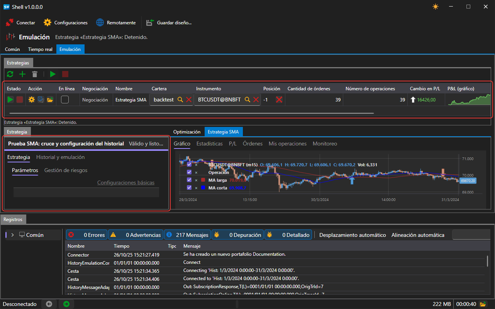
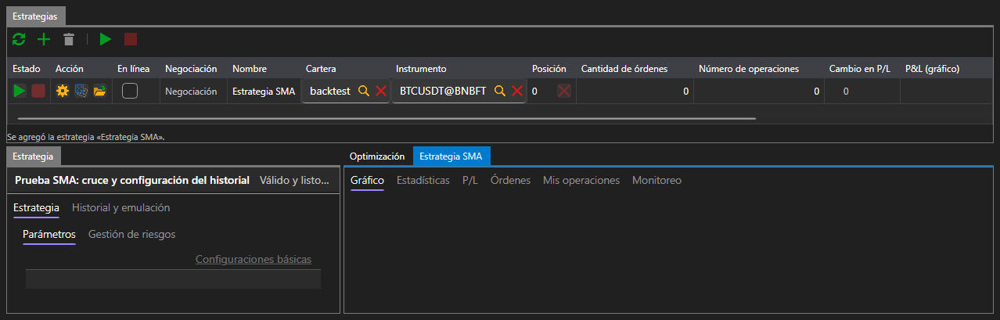
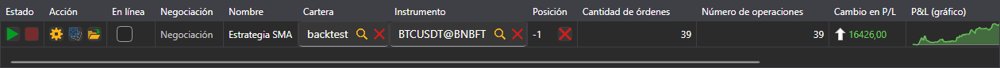
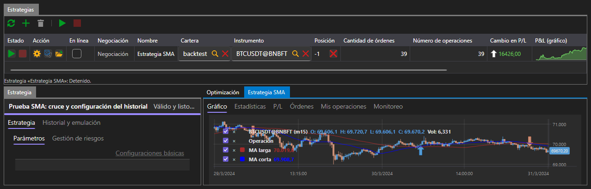
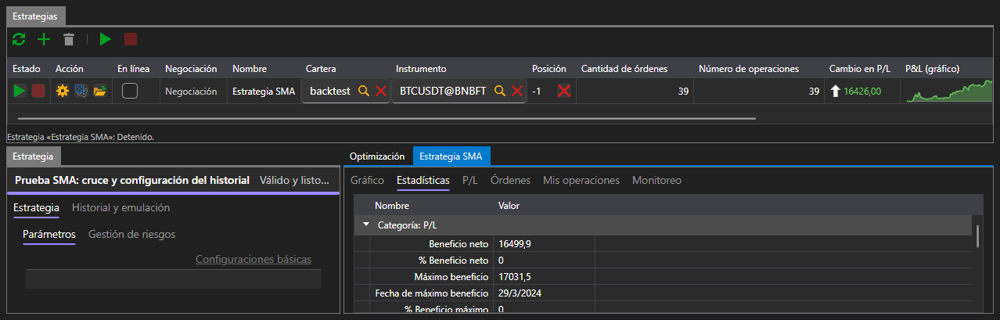
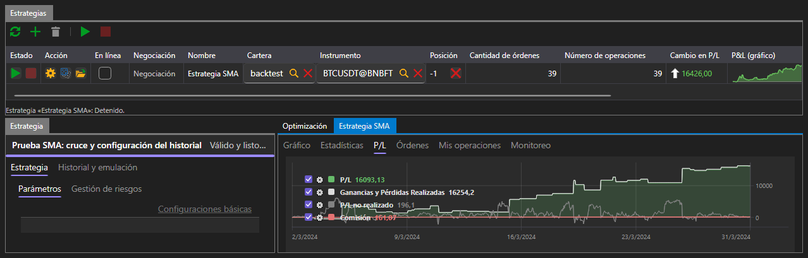
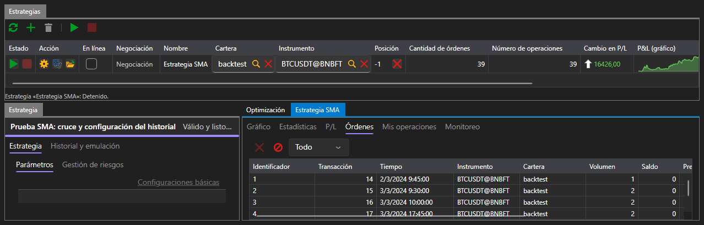
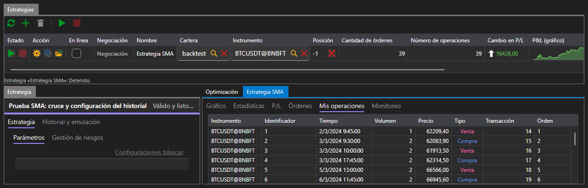

# Emulación

La pestaña **Emulación** ejecuta la estrategia sobre datos históricos. Para ello no hace falta conexión: cada ejecución lee el historial del disco a través de su propio conector de emulación.

El área está organizada igual que [Tiempo real](real_time.md): arriba, la tabla **Estrategias** con los botones; a la izquierda, el panel de la estrategia seleccionada; a la derecha, pestañas con todo lo que ha producido la ejecución. Las diferencias son dos pestañas en el panel de la estrategia y la pestaña **Optimización** entre los resultados.

## Parámetros de la ejecución

A la izquierda está el panel **Estrategia**, donde se define todo con lo que la estrategia irá al historial. Tiene dos pestañas:

- **Estrategia**: instrumento, cartera, volumen, reglas de riesgo y parámetros propios de la estrategia;
- **Historial y emulación**: de dónde tomar los datos y cómo entregarlos a la estrategia.

| Parámetro | Qué define |
|---|---|
| **Ruta del historial** | carpeta de la que la ejecución lee velas y ticks |
| **De**, **Hasta** | primer y último día de la ejecución |
| **Formato de almacenamiento** | de qué forma está el historial en el disco |
| **Ejecutar al tocar** | ejecutar la orden al tocar el precio, sin esperar a que lo atraviese |
| **Comprobar el estado de la negociación** | rechazar las órdenes mientras el mercado no está negociando |
| **Latencia (ms)** | retraso entre el envío de la orden y su recepción por el mercado |

De forma predeterminada se usa el historial que se instala junto con la plataforma y el período que ese historial cubre, es decir, la primera ejecución se puede iniciar sin cambiar nada.

Si los parámetros están mal rellenados (no se indica la ruta, el fin del período es anterior al inicio, la latencia es negativa), debajo de la tabla aparece un mensaje al respecto y la ejecución no empieza.

## Ejecución

El botón **Iniciar** comienza la ejecución, y la barra situada bajo el título del panel muestra cuánto se ha recorrido. La ejecución termina sola cuando se acaba el historial; el botón **Cancelar** la detiene antes.

Durante la ejecución y después de ella, la tabla de estrategias muestra lo mismo que en la negociación: estado, posición, número de órdenes y operaciones, ganancias y pérdidas.

## Resultado

A la derecha están las pestañas entre las que se reparte todo lo que ha producido la ejecución:

| Pestaña | Qué muestra |
|---|---|
| **Gráfico** | las velas del instrumento y las operaciones de la estrategia sobre ellas |
| **Estadísticas** | todos los indicadores que calcula la plataforma |
| **P/L** | la curva de rentabilidad |
| **Órdenes** | todas las órdenes que ha registrado la estrategia |
| **Mis operaciones** | todas las operaciones que ha realizado |
| **Optimización** | [búsqueda de parámetros](optimization.md) |

### Gráfico

En el gráfico están las velas del instrumento con el que se ha hecho la ejecución y las marcas de las operaciones de la estrategia sobre ellas.

### Estadísticas

Las estadísticas están agrupadas por secciones: ganancias y pérdidas, operaciones, órdenes, latencias. Entre otras cosas, muestran el beneficio neto, la reducción máxima en dinero y en porcentaje, el número de operaciones rentables y con pérdidas, el beneficio medio por operación, el factor de beneficio y los ratios de Sharpe, Sortino, Calmar y Sterling.

El número de operaciones de las estadísticas es menor que el de la tabla de estrategias: las estadísticas cuentan las operaciones que han cerrado algo, y la operación que abrió la primera posición no se incluye.

### P/L

La curva de rentabilidad muestra cómo ha cambiado el resultado de la estrategia durante la ejecución.

### Órdenes y operaciones

En la pestaña **Órdenes** está todo lo que ha registrado la estrategia: hora, dirección, tipo, volumen, precio y estado de cada orden.

En la pestaña **Mis operaciones**, lo que se ha ejecutado de esas órdenes.

## Contenido recomendado

[Optimización](optimization.md)

[Tiempo real](real_time.md)
