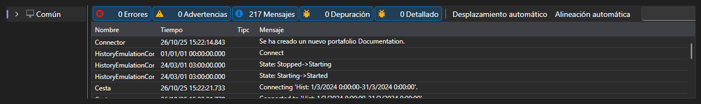

# Registros

La pestaña **Registros** muestra todo lo que la aplicación comunica sobre su funcionamiento: mensajes de la conexión, de las estrategias, de la emulación y del propio Shell.

Cada entrada consta de la hora, el nivel (depuración, información, advertencia, error), el origen y el texto. Las entradas de las estrategias están marcadas con el identificador de la estrategia, por lo que, con varias estrategias funcionando a la vez, se ve de quién es cada mensaje.

Encima de la tabla se muestra cuántos errores y advertencias se han acumulado, y un botón que vacía el registro. La propia tabla permite filtrar las entradas por nivel, buscar por texto, elegir las columnas y exportar el contenido.

Los registros son el primer sitio donde mirar si una estrategia no se inicia, no registra órdenes o la ejecución sobre historial termina justo después de empezar.

## Contenido recomendado

[Común](common.md)
