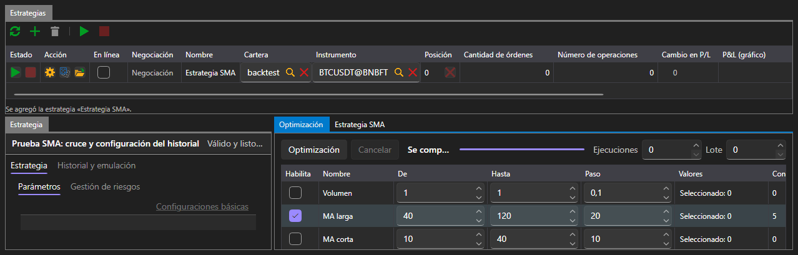

# Optimización

La pestaña **Optimización** elige los parámetros de la estrategia por búsqueda exhaustiva: ejecuta la misma estrategia sobre el mismo historial tantas veces como combinaciones de parámetros resultan y muestra el resultado de cada ejecución.

La optimización solo está disponible en el área [Emulación](emulation.md). En [Tiempo real](real_time.md) esta pestaña no existe: con una conexión real no hay con qué iterar los parámetros.

## Qué iterar

La tabla de parámetros enumera los parámetros de la estrategia seleccionada que se pueden iterar. Un parámetro participa en la iteración solo si está marcado; para uno marcado se definen el inicio, el fin y el paso. Lo que se puede introducir depende del tipo de parámetro: en un número entero son valores enteros; en uno booleano, solo dos valores.

A la derecha de los botones se definen los límites de la iteración:

| Campo | Qué define |
|---|---|
| **Ejecuciones** | cuántas ejecuciones hacer como máximo; 0, sin límite |
| **Lote** | cuántas ejecuciones realizar a la vez |

El número de combinaciones se recalcula a medida que se marcan los parámetros, por lo que se ve de antemano en qué resultará la iteración.

## Progreso de la iteración

El botón **Optimización** inicia la iteración y **Cancelar** la detiene. La barra de estado indica lo que ocurre: se está planificando la iteración, se están realizando tantas ejecuciones, la iteración se ha detenido después de tantas ejecuciones, la iteración no ha producido ninguna ejecución. La barra de al lado muestra cuánto se ha recorrido.

## Resultado

El resultado se muestra de tres formas a la vez:

- una tabla en la que cada fila es una ejecución con sus valores de parámetros, beneficio final y curva de rentabilidad;
- una superficie según dos parámetros elegidos;
- la misma superficie en forma de mapa de calor.

Al seleccionar una fila de la tabla se muestra la curva de rentabilidad de esa ejecución.

## Contenido recomendado

[Emulación](emulation.md)
