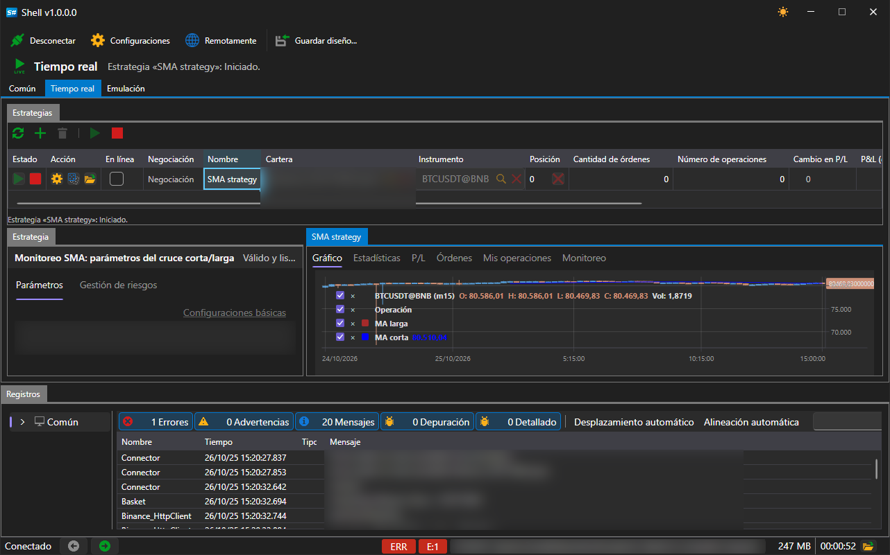

# Tiempo real

La pestaña **Tiempo real** gestiona las estrategias lanzadas en negociación.

El área consta de tres partes:

- **Estrategias**: la tabla de todas las estrategias del área y los botones para gestionarlas, arriba;
- **Estrategia**: los parámetros de la estrategia seleccionada, a la izquierda;
- las pestañas de la derecha (**Gráfico**, **Estadísticas**, **P/L**, **Órdenes** y **Mis operaciones**): todo lo que la estrategia seleccionada muestra, registra y realiza.

Solo se puede trabajar con esta área con la conexión establecida: sin ella, los botones no están disponibles, y debajo de la tabla se muestra una sugerencia al respecto.

## Botones

| Botón | Qué hace |
|---|---|
| **Actualizar** | vuelve a leer la lista de estrategias |
| **Añadir** | abre la ventana de selección de estrategia |
| **Eliminar** | quita la estrategia seleccionada del área |
| **Iniciar** | inicia la estrategia seleccionada en negociación |
| **Detener** | la detiene |

## Tabla de estrategias

Cada fila es una estrategia. Las columnas muestran su estado y su resultado:

| Columna | Qué muestra |
|---|---|
| **Estado** | detenida, iniciándose, en funcionamiento, deteniéndose |
| **Acción** | inicio, detención y cierre de la posición directamente desde la fila |
| **En línea** | si la estrategia recibe datos en tiempo real |
| **Negociación** | modo de negociación de la estrategia |
| **Nombre** | nombre dado al añadirla |
| **Cartera**, **Instrumento** | con qué opera |
| **Posición** | posición actual |
| **Cantidad de órdenes**, **Número de operaciones** | cuántas órdenes se han registrado y cuántas operaciones se han realizado |
| **Cambio en P/L**, **P&L (gráfico)** | ganancias y pérdidas y su evolución |
| **Beneficio realizado**, **Beneficio no realizado** | parte cerrada y abierta del resultado |
| **Error** | último error de la estrategia, si lo ha habido |

## Añadir una estrategia

El botón **Añadir** abre una ventana con la lista de estrategias disponibles.

La ventana enumera las cuatro estrategias incluidas y todo lo que se ha importado de [Designer](../run_strategies_from_designer.md). El botón **Importar** añade a esta lista un esquema exportado desde Designer; el botón **Nuevo**, una plantilla para una estrategia propia; el botón **Eliminar** quita de la lista la entrada seleccionada.

Después de pulsar **OK**, la estrategia aparece en la tabla y en el panel **Estrategia** se abren sus parámetros: instrumento, cartera, volumen, reglas de riesgo y parámetros propios de la estrategia, por ejemplo, las longitudes de las medias móviles y el marco temporal de las velas para **SMA strategy**.

## Contenido recomendado

[Común](common.md)

[Emulación](emulation.md)
