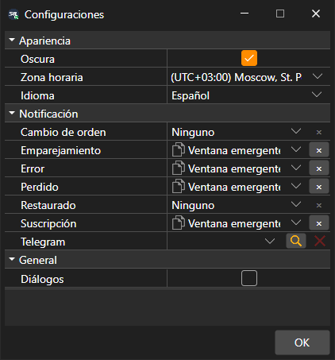

# Configuración general

La ventana **Configuraciones** se abre con la opción **Configuraciones → Configuraciones** del [menú principal](../user_interface/ribbon.md). Su configuración está dividida en grupos:

- **Apariencia**:
  - **Oscura**: tema oscuro; también lo cambia el botón del título de la ventana;
  - **Zona horaria**: en qué zona horaria se muestra la hora de los datos de mercado;
  - **Idioma**: idioma del programa.
- **General**:
  - **Diálogos**: mostrar una ventana con el error que el programa no ha gestionado por sí mismo. Si la casilla está desmarcada, ese error solo se escribe en el registro.
- **Notificación**: de qué eventos de las órdenes y de la conexión informar y de qué manera, así como el canal de Telegram para esos mensajes. Con más detalle, en la sección [Notificaciones](../notifications.md).

El tema se cambia en cuanto se pulsa **OK**. El idioma y la zona horaria se aplican después de reiniciar, por lo que Terminal pregunta si desea reiniciarse ahora.

## Véase también

[Restablecer configuración](reset_settings.md)

[Notificaciones](../notifications.md)
