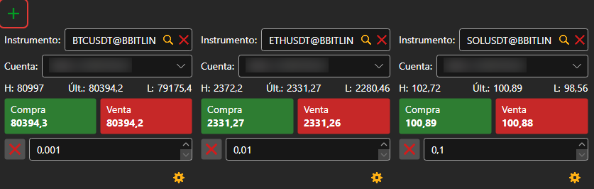
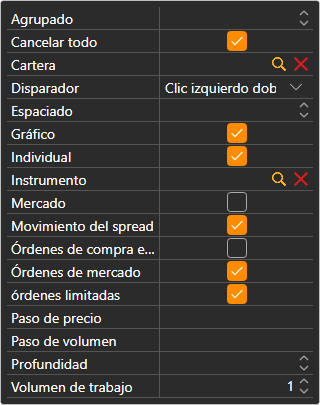

# Comprar/Vender

El componente **Comprar/Vender** es un grupo de tickets. Cada ticket muestra los mejores precios de un instrumento y registra órdenes sobre él en la cartera seleccionada. Un ticket se añade con el botón ; en la primera conexión, el panel crea por sí solo tickets para los primeros instrumentos del mercado.

## Configuración del ticket

El botón con el engranaje situado debajo del ticket abre su configuración: **Instrumento**, **Cartera**, **Volumen de trabajo**, **Profundidad** del libro de órdenes y qué bloques muestra el ticket:

- **Órdenes limitadas**: los botones **Comprar** y **Vender** con un campo de precio entre ellos; los botones junto al campo ponen en él el mejor precio de compra o de venta;
- **Órdenes de mercado**: **Comprar**, **Vender**, **Cerrar posición** e **Invertir posición** a mercado;
- **Cancelar todo**: un botón que cancela todas las órdenes del instrumento del ticket.

El instrumento del ticket se puede cambiar arrastrando al ticket una fila de [Instrumentos](instruments.md); si se arrastra una fila de [Posiciones](positions.md), el ticket toma su instrumento y su cartera.

## Teclas de acceso rápido

El ticket del panel **Comprar/Vender** del [área de trabajo](../workspace.md) abierta en ese momento responde a las teclas: **F9**, comprar a mercado; **F10**, vender a mercado; **Esc**, cancelar todas las órdenes. Mientras el cursor está en un campo de entrada, las teclas no funcionan.

> [!WARNING]
> **F9** y **F10** envían al mercado órdenes de mercado reales sin confirmación.

## Contenido recomendado

[Libro de órdenes](order_book.md)

[Level 2](level_2.md)

[Menú principal](../ribbon.md)
