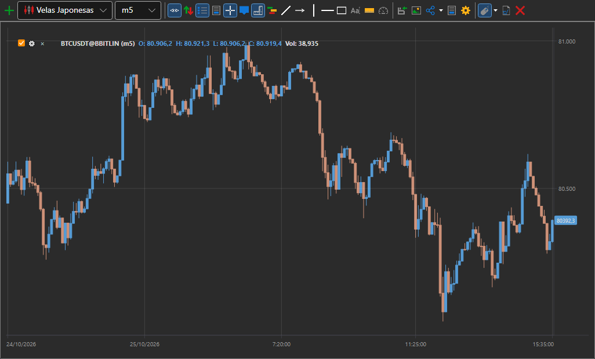
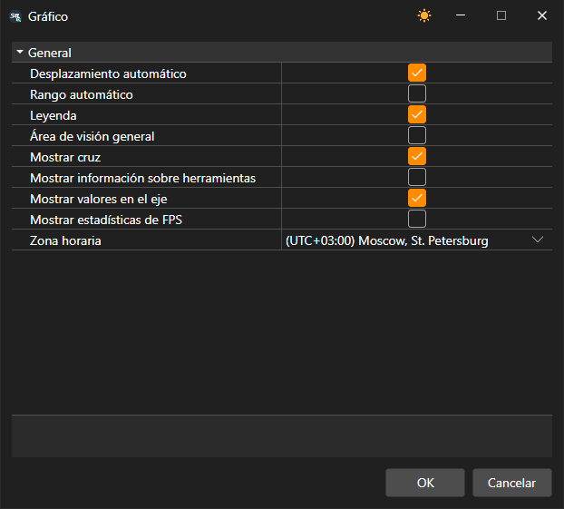

# Gráfico

El componente **Gráfico** permite dibujar velas e indicadores para el instrumento seleccionado.

Para añadir una nueva área, haga clic en el botón .

Para añadir un nuevo elemento al gráfico, haga clic derecho en cualquier lugar del área del gráfico y seleccione el elemento requerido; las opciones disponibles incluyen velas, indicadores, órdenes y operaciones propias.

La esquina superior izquierda de cada gráfico muestra todos los elementos gráficos añadidos al gráfico. Si desmarca la casilla  de un elemento gráfico, ese elemento también se elimina del gráfico.

Al hacer clic en , se abre la configuración del elemento gráfico.

## Negociación desde el gráfico

Desde el gráfico se pueden registrar, mover y cancelar órdenes. Primero se activa el interruptor **Colocar órdenes desde el gráfico** de la barra de botones del gráfico y, en su configuración desplegable, se indican el **Instrumento**, la **Cartera** y el volumen de la orden.

- Una orden de compra se registra con la combinación **Ctrl+botón izquierdo del ratón** sobre un precio del gráfico, y una orden de venta, con **Ctrl+botón derecho del ratón**.
- Las órdenes activas propias se dibujan en el gráfico como líneas en sus precios. Una línea se puede arrastrar a otro precio y la orden se moverá; la cruz junto a la línea cancela la orden. El botón **Cancelar órdenes** cancela todas las órdenes del gráfico.
- El botón **Mostrar el panel de entrada de órdenes rápidas** muestra sobre el gráfico un panel con los botones **Vender** al mejor precio de compra y **Comprar** al mejor precio de venta, el spread entre ellos y el volumen de la orden. El panel se puede arrastrar a cualquier lugar del gráfico.

> [!WARNING]
> Las órdenes desde el gráfico se envían al mercado de inmediato, sin confirmación.

## Configuración del gráfico

El botón **Configuraciones** de la barra de botones del gráfico abre la ventana de configuración de todo el gráfico: desplazamiento automático y escala automática, leyenda, área de visualización, cruz, descripción emergente, valores en los ejes, estadísticas de FPS y la zona horaria con la que se rotula la escala de tiempo.

Un clic derecho en la propia barra de botones abre la lista de sus botones: la casilla desmarcada oculta el botón y la marcada lo vuelve a mostrar. Los botones que se muestran se guardan junto con el gráfico.

El botón **Portapapeles (como imagen)** copia la imagen del gráfico para pegarla en un mensaje o un documento. Un clic derecho en un elemento del gráfico abre un menú con las opciones **Parámetros de elemento…** y **Eliminar**; en el menú del área del gráfico están **Configuraciones → Área del gráfico…** y **Quitar panel**. El panel situado debajo del gráfico también se cierra con la cruz de su título.

El gráfico se desplaza con las flechas **←** y **→**, las teclas **Home** y **End** van al principio y al final de los datos, y **+** y **−** cambian la escala.

En la configuración del elemento gráfico, puede establecer el estilo de gráfico requerido: velas japonesas, barras, gráfico Box, perfil de clúster, etc.

Para un gráfico Box, las velas también se pueden agrupar; el orden de agrupación se establece en los campos: multiplicador del segundo marco temporal y multiplicador del tercer marco temporal.

Sobre el gráfico hay una barra de herramientas donde puede seleccionar desplazamiento automático, zoom automático, modos de leyenda y otros ajustes generales del gráfico. También puede seleccionar los elementos que se dibujarán en el gráfico: líneas, niveles, punteros, rectángulo, texto.

## Véase también

[Órdenes](../../../designer/user_interface/components/orders.md)
