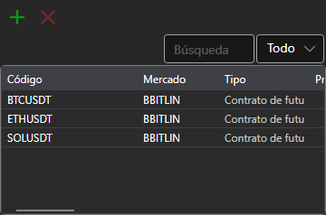

# Instrumentos

El componente **Instrumentos** (el título del panel es **Instrumentos**) es una tabla con instrumentos que muestra información sobre todos los instrumentos seleccionados.

Para añadir un nuevo instrumento, haga clic en el botón . Se abrirá la ventana de selección de instrumentos: tiene búsqueda, filtro por tipo de instrumento y por mercado, y mientras se carga la lista de instrumentos, debajo de la tabla se ve una barra de carga. El botón **Eliminar instrumentos** quita de la tabla los instrumentos seleccionados.

El instrumento seleccionado en la tabla se muestra en el panel **Propiedades** de la misma área de trabajo. Si el gráfico del área todavía no tiene un instrumento para el que registra órdenes, el instrumento seleccionado pasa a ser ese instrumento.

La fila de un instrumento se puede arrastrar con el ratón a otro panel del área ([Comprar/Vender](buy_sell.md), [Level 1](level_1.md), [Level 2](level_2.md), [Libro de órdenes](order_book.md) o [Gráfico](chart.md)), y el panel cambiará a ese instrumento.

Cómo copiar las filas, buscarlas y filtrarlas, y configurar las columnas se describe en la sección [Trabajo con tablas](../tables.md).

## Contenido recomendado

[Level 1](level_1.md)
