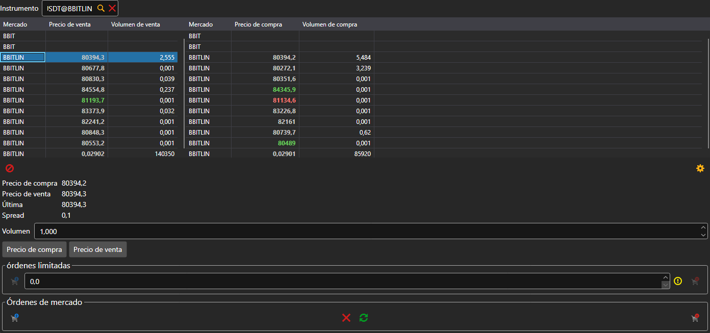

# Level 2

El componente **Level 2** muestra las cotizaciones de un instrumento en todos los mercados a la vez: en las tablas entra cada instrumento con el mismo código, una fila por instrumento. En la tabla de la izquierda están el mejor precio y el volumen de venta; en la de la derecha, los de compra. El instrumento se elige en el campo situado encima de las tablas o se arrastra al panel desde [Instrumentos](instruments.md).

Debajo de las tablas están el precio de compra, el precio de venta, el último precio y el spread de la fila seleccionada en la tabla. Los botones **Precio de compra** y **Precio de venta** ponen ese precio en la orden limitada, y más abajo está el mismo ticket que en el componente [Comprar/Vender](buy_sell.md): órdenes limitadas y de mercado.

## Contenido recomendado

[Libro de órdenes](order_book.md)

[Comprar/Vender](buy_sell.md)
