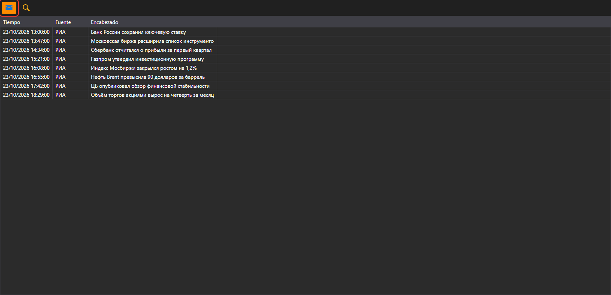

# Noticias

El componente **Noticias** muestra noticias recibidas desde conexiones.

Para empezar a recibir noticias, haga clic en el botón **Recibir noticias**.

## Contenido recomendado

[Posiciones (opciones)](positions_options.md)
