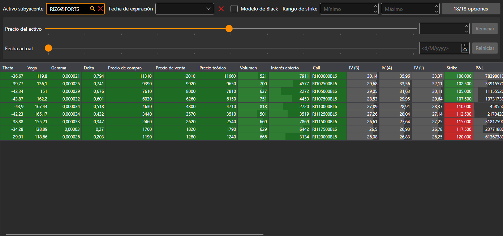

# Mesa de opciones

El componente **Mesa de opciones** es una tabla con los principales parámetros de las opciones para el instrumento subyacente: cada fila de la tabla es un strike; a la izquierda, los parámetros de la opción call y, a la derecha, los de la put.

## Filtro de opciones

Encima de la tabla hay un filtro. Es igual en todos los componentes de opciones: la mesa, la [sonrisa de volatilidad](smile_volatility.md) y las [posiciones por opciones](positions_options.md):

- **Activo subyacente**: el instrumento cuyas opciones se muestran;
- **Fecha de expiración**: mostrar solo las opciones de esta fecha de expiración; el botón de al lado borra el filtro;
- **Modelo de Black**: calcular los precios teóricos, la volatilidad y las griegas con el modelo de Black (para opciones sobre futuros) y no con el modelo de Black-Scholes;
- **Rango de strike**: strike mínimo y máximo;
- el botón con el número de opciones abre la ventana de selección de opciones del activo subyacente. En el botón se ve cuántas de las opciones seleccionadas pasan el filtro y cuántas hay seleccionadas en total.

Debajo del filtro está el cálculo «qué pasaría si». El control deslizante **Precio del activo** y el campo de al lado definen otro precio del activo subyacente, y el control deslizante **Fecha actual** y el calendario, otra fecha actual. Los cálculos del componente se hacen para estos valores, y los botones **Reiniciar** devuelven el precio y la fecha reales.

## Tabla

Los strikes «dentro del dinero» están resaltados: en la call son los strikes inferiores al precio del activo subyacente y, en la put, los superiores.

Un doble clic en una celda de la call o de la put abre el libro de órdenes de esa opción.

## Contenido recomendado

[Sonrisa de volatilidad](smile_volatility.md)
