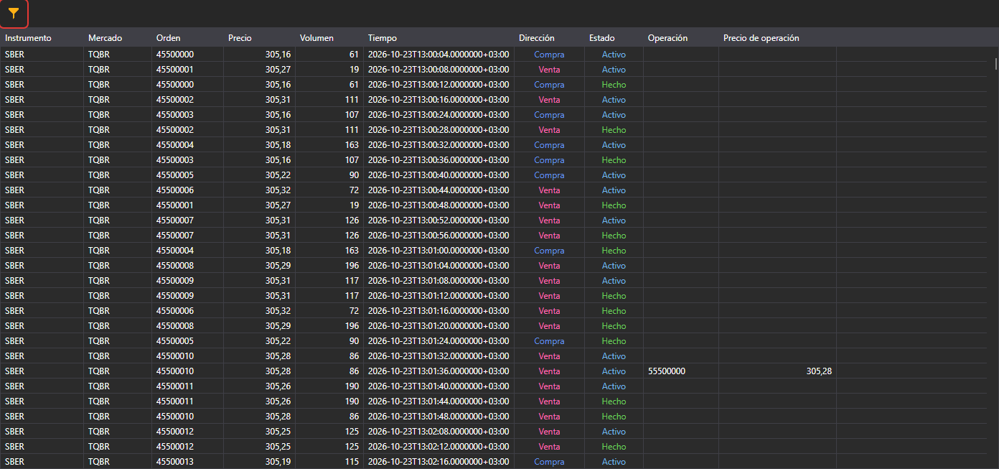

# Registro de órdenes

El componente **Registro de órdenes** es una tabla con órdenes que muestra información completa sobre todas las órdenes de los instrumentos seleccionados.

**Registro de órdenes** tiene un filtro para seleccionar los instrumentos necesarios.

## Contenido recomendado

[Almacenamiento de datos de mercado](../../market_data_storage.md)
