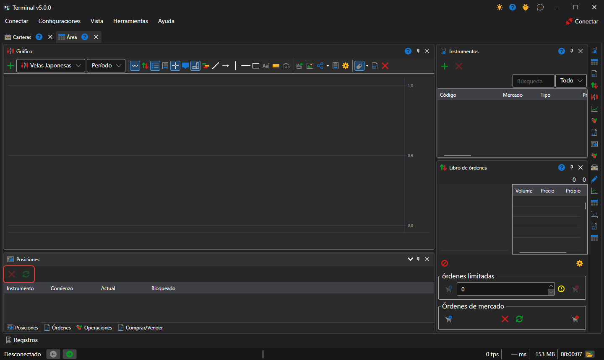

# Posiciones

El componente **Posiciones** es una tabla de las posiciones actuales por instrumentos y carteras: volumen, precio medio, ganancias y pérdidas.

Encima de la tabla están los botones **Cerrar posición** (una orden a mercado que lleva a cero la posición seleccionada) e **Invertir posición** (una orden a mercado por el doble del volumen de la posición, tras la cual la posición tiene el mismo tamaño, pero en sentido contrario). La fila de una posición se puede arrastrar a un ticket [Comprar/Vender](buy_sell.md): el ticket toma su instrumento y su cartera.

## Contenido recomendado

[Posiciones](../../../designer/user_interface/components/positions.md)

[Comprar/Vender](buy_sell.md)
