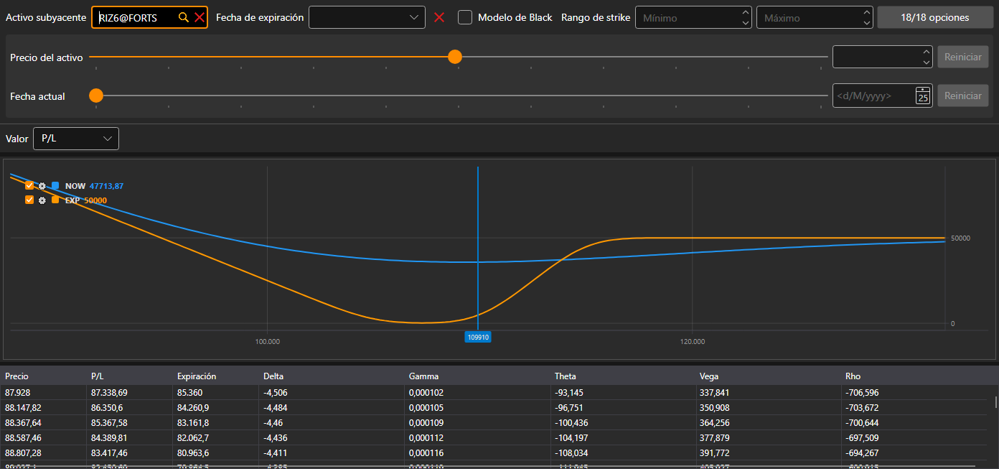

# Posiciones (opciones)

**Posiciones (opciones)** es una representación gráfica de la posición por opciones: cómo depende su indicador del precio del activo subyacente.

Las opciones se eligen con el mismo filtro que en la [mesa de opciones](option_desk.md): activo subyacente, fecha de expiración, rango de strikes y las propias opciones. El cálculo «qué pasaría si» debajo del filtro muestra la posición con otro precio del activo subyacente y en otra fecha.

En la lista **Valor** se elige qué representar: **P/L**, **Delta**, **Gamma**, **Theta**, **Vega** o **Rho**. Debajo del gráfico hay una tabla de valores según los precios del activo subyacente: **Precio**, P/L actual, P/L a la **Expiración** y las griegas.

## Contenido recomendado

[Mesa de opciones](option_desk.md)
