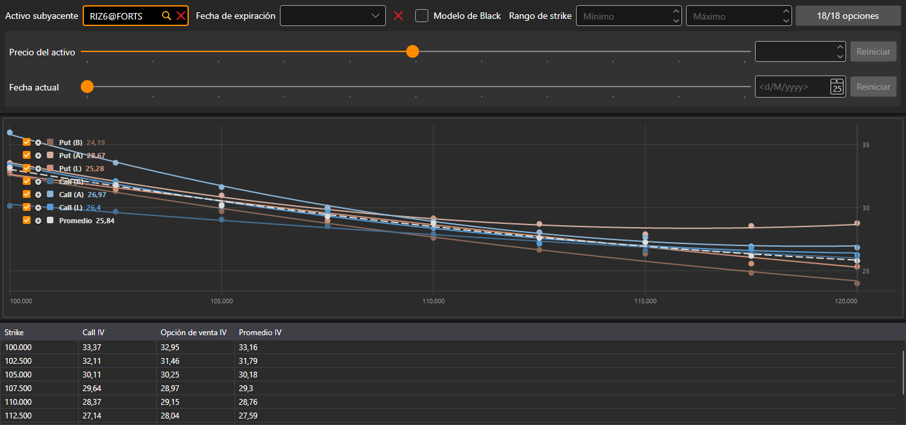

# Sonrisa de volatilidad

El componente **Sonrisa de volatilidad** es una representación gráfica del nivel esperado de volatilidad para opciones con el mismo activo subyacente y distintos strikes.

Las opciones se eligen con el mismo filtro que en la [mesa de opciones](option_desk.md): activo subyacente, fecha de expiración, rango de strikes y las propias opciones.

En el gráfico hay siete curvas: la volatilidad implícita de las call y de las put según el mejor precio de compra, según el mejor precio de venta y según el precio de la última operación y, con línea discontinua, el **Promedio** de la volatilidad de la call y de la put en cada strike. Debajo del gráfico hay una tabla: **Strike**, la volatilidad de la **Call** y de la **Opción de venta** (según el precio de la última operación o, si no hubo operaciones, según el mejor precio de compra o de venta) y su **Promedio**.

## Contenido recomendado

[Mesa de opciones](option_desk.md)

[Posiciones (opciones)](positions_options.md)
