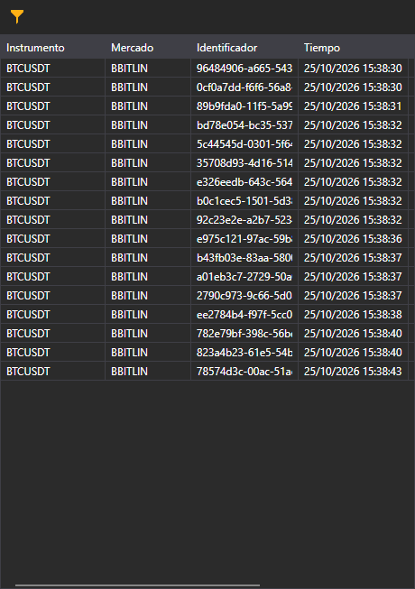

# Flujo de operaciones

La cinta de operaciones de Terminal muestra las operaciones de mercado de los instrumentos seleccionados. La guía compartida de operaciones tick explica el filtro de instrumentos de este componente.

Consulte

[Operaciones tick](../../../designer/user_interface/components/tick_trades.md)
