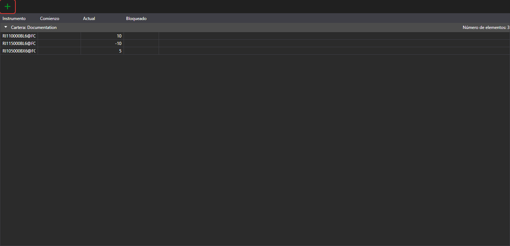

# Carteras

El panel **Carteras** muestra los datos de las carteras y sus posiciones. Se abre con la opción **Vista → Carteras** del [menú principal](ribbon.md).

El botón  crea una posición, y su menú desplegable, una cartera o una posición. Un doble clic en una fila abre la posición para editarla.

En el menú que se abre con un clic derecho en una fila, además de las opciones comunes de las [tablas](tables.md), están:

- **Editar**: abrir la posición para editarla;
- **Cerrar posición**: registrar una orden a mercado que cierra la posición;
- **Invertir posición**: registrar una orden a mercado por el doble del volumen de la posición, para que la posición cambie de dirección;
- **Retirar**: retirar fondos del mercado; en la ventana se indican el volumen y los datos de la retirada. La opción está disponible para una posición positiva en un activo si la conexión de la cartera admite la retirada de fondos;
- **Ocultar saldos cero**: no mostrar las posiciones con saldo cero.

Más información sobre las carteras, las posiciones y su edición en la guía compartida: [Carteras](../../designer/user_interface/portfolios.md).
