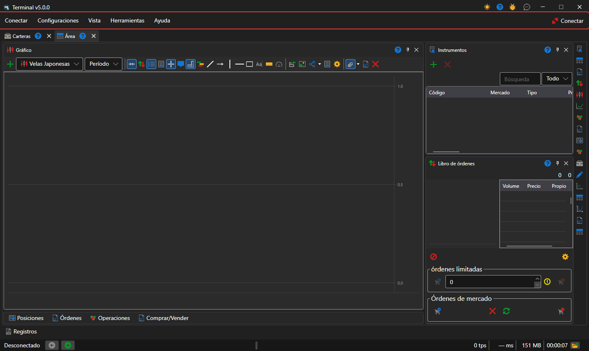
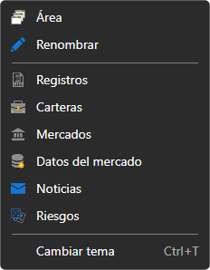

# Menú principal

Debajo del título de la ventana de [Terminal](../../terminal.md) está la barra de menús: **Conectar**, **Configuraciones**, **Vista**, **Herramientas** y **Ayuda**. Al final de la barra está el botón **Conectar**: conecta Terminal a todas las [conexiones configuradas](../connection_settings.md) y, mientras la conexión está establecida, se llama **Desconectar**. Mientras Terminal está conectado, la configuración de las conexiones y del emulador no está disponible.

En el título de la ventana, junto a los botones de minimizar y cerrar, están los botones de cambio de tema, de ayuda, **Informar de un problema** y **Contáctenos**.

## Opciones del menú

- **Conectar**: conexión y desconexión, [configuración de conexiones](../connection_settings.md) y configuración del emulador, que ejecuta las órdenes con datos de mercado reales sin enviarlas al mercado.
- **Configuraciones**: [configuración general](../settings/common_settings.md) del programa; **Guardar diseño** y **Restablecer diseño**, que devuelve los paneles a sus posiciones originales; [restablecimiento de la configuración](../settings/reset_settings.md); las ventanas **Instrumentos y conexiones** y **Carteras y conexiones**, en las que se asigna a un instrumento o a una cartera la conexión a través de la que se negocia.
- **Vista**: nueva [área de trabajo](workspace.md) (**Área**) y cambio de nombre de la actual (**Renombrar**); paneles de toda la ventana: [Registros](logs.md), [Carteras](portfolios.md), [Editor de mercados](board_editor.md), **Datos de mercado**, [Noticias](components/news.md), [Riesgos](risk_management.md); cambio de tema.
- **Herramientas**: **Crear un nuevo instrumento**, **Nuevo instrumento de índice** a partir de varios instrumentos e **Instrumento continuo** a partir de futuros de distintos vencimientos; el instrumento creado aparece de inmediato en [Instrumentos](components/instruments.md) del área abierta.
- **Ayuda**: **Documentación**, **Informe de errores**, contacto con el equipo de StockSharp y la ventana **Acerca del programa**.

## Teclas de acceso rápido

| Teclas | Acción |
|---|---|
| **F5** | conectar o desconectar |
| **Ctrl+,** | configuración de conexiones |
| **Ctrl+S** | guardar el diseño |
| **Ctrl+T** | cambiar el tema |
| **F1** | abrir la ayuda |
| **Alt+C**, **Alt+S**, **Alt+V**, **Alt+T**, **Alt+H** | abrir los menús **Conectar**, **Configuraciones**, **Vista**, **Herramientas**, **Ayuda** |
| **F9** | comprar a mercado en el ticket activo [Comprar/Vender](components/buy_sell.md) |
| **F10** | vender a mercado en el ticket activo |
| **Esc** | cancelar todas las órdenes del ticket activo |

El ticket activo es el ticket del panel **Comprar/Vender** del área de trabajo abierta en ese momento. Las teclas **F9**, **F10** y **Esc** no funcionan mientras el cursor está en un campo de entrada.

> [!WARNING]
> **F9** y **F10** envían al mercado órdenes de mercado reales sin confirmación.

## Contenido recomendado

[Área de trabajo](workspace.md)

[Componentes](components.md)
