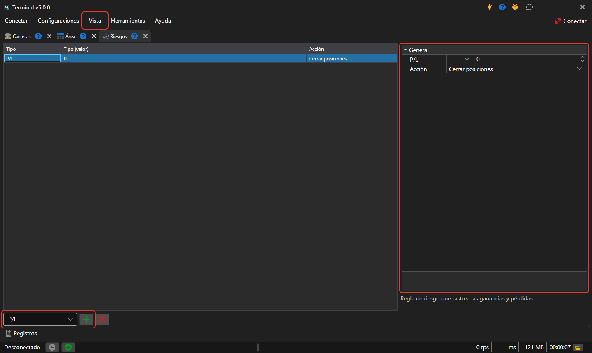

# Gestión de riesgos

En el panel **Riesgo**, puede establecer la configuración de control de riesgos. El panel se abre con la opción **Vista → Riesgos** del [menú principal](ribbon.md).

Para añadir una **Regla de riesgo**, hay que seleccionar su tipo en la lista situada debajo de la tabla y pulsar el botón **Añadir regla**. La regla aparecerá en la tabla y, a la derecha, su configuración: la condición de activación de la **Regla de riesgo** y la acción (Cerrar posiciones, Detener negociación, Cancelar órdenes) que se ejecutará cuando se cumpla la condición. Debajo de la configuración se muestra la descripción de la regla seleccionada. El botón **Eliminar regla** elimina las reglas seleccionadas.

Las reglas las comprueba la conexión de Terminal, sobre las órdenes, las operaciones y los datos de cartera que pasan por ella. El conjunto de reglas se guarda entre inicios del programa.

La lista de reglas de riesgo y su descripción está disponible en la sección [Gestión de riesgos](../../designer/user_interface/risk_management.md).
