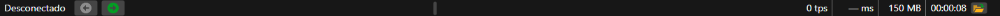

# Barra de estado

En la parte inferior de la ventana de [Terminal](../../terminal.md) está la barra de estado. De izquierda a derecha contiene:

- **estado**: **Desconectado**, **Conectando**, **Conectado**, **Desconectando** o el texto del error de conexión. Aquí también escribe Terminal el resultado de la última acción, por ejemplo, «Disposición guardada.» o «Instrumento creado: …»;
- **noticias de StockSharp**: los titulares de las noticias del sitio web, que se pueden pasar con los botones de flecha;
- **contadores de advertencias y errores** del registro: aparecen cuando el registro contiene advertencias o errores;
- **último mensaje del registro**: un clic derecho sobre él copia su texto al portapapeles. El registro completo está en el panel [Registros](logs.md);
- **ticks por segundo** (tps): cuántas operaciones de mercado (ticks) ha recibido Terminal en el último segundo;
- **latencia** (ms): cuántos milisegundos más tarde que su hora en el mercado han llegado el último tick o el último cambio de Level 1;
- **memoria** ocupada por los datos de Terminal, en megabytes;
- **tiempo de funcionamiento** del programa desde su inicio;
- el botón **Directorio de registros**: abre la carpeta en la que Terminal escribe el registro.

Mientras Terminal no está conectado, los ticks y la latencia no se cuentan: en la barra aparecen **0 tps** y **— ms**.

## Véase también

[Registros](logs.md)

[Menú principal](ribbon.md)
