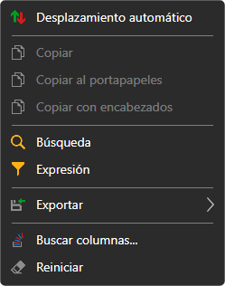
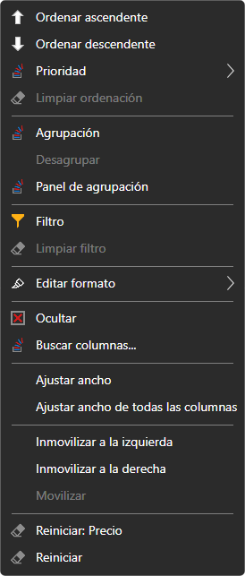

# Trabajo con tablas

Las tablas de todos los paneles de [Terminal](../../terminal.md) (instrumentos, órdenes, operaciones, posiciones, carteras, Level 1, registro de órdenes, noticias) funcionan igual.

## Menú de la tabla

Un clic derecho en las filas de la tabla abre el menú:

- **Desplazamiento automático**: la tabla se desplaza sola hasta las filas nuevas;
- **Copiar**, **Copiar al portapapeles**: copian las filas seleccionadas al portapapeles: las columnas visibles en el orden en que se muestran, separadas por tabulaciones; cada fila de la tabla es una línea de texto. **Copiar con encabezados** añade como primera línea los nombres de las columnas. Lo mismo que **Copiar** lo hace **Ctrl+C**;
- **Búsqueda** (**Ctrl+F**): búsqueda de texto en la tabla. Se puede elegir en qué columnas buscar; los botones **Anterior** y **Siguiente** pasan de una celda encontrada a otra, y **Limpiar** restablece la búsqueda;
- **Expresión**: filtro de filas con una condición sobre los valores de las columnas, en forma de fórmula, por ejemplo, `=[Price] > 100`. El campo sugiere los nombres de las columnas y las funciones (`CONTAINS`, `STARTSWITH`, `ENDSWITH`, `TODAY`, `NOW` y otras), muestra de inmediato un error en la fórmula, y **Vista previa** muestra lo que da la fórmula para la fila seleccionada. **Aplicar** activa el filtro y **Limpiar filtro** lo quita;
- **Exportar**: la tabla al portapapeles (como texto en formato CSV o como imagen), a un archivo CSV, Excel o PNG. **Compartir enlace de la imagen** publica la imagen de la tabla en el sitio web de StockSharp y copia el enlace a ella; para ello hay que iniciar sesión en el sitio web. **Imprimir** abre la tabla en el navegador, desde donde se puede imprimir;
- **Buscar columnas...**: ventana en la que se muestran y ocultan las columnas;
- **Reiniciar**: devolver la tabla a su aspecto original.

## Menú de la columna

Un clic derecho en el encabezado de una columna abre el menú de esa columna:

- **Ordenar ascendente**, **Ordenar descendente**, **Limpiar ordenación**. Un clic en el encabezado también ordena la tabla por esa columna. **Prioridad** añade la ordenación por la columna a la ya definida, para ordenar por varias columnas a la vez;
- **Agrupación**: agrupar las filas por los valores de la columna; **Desagrupar**. **Panel de agrupación** muestra los niveles de agrupación: una columna se puede añadir desde la lista o arrastrar al panel por el encabezado, los niveles se reordenan y cada nivel tiene su propia dirección de ordenación;
- **Filtro**: filtro de filas por los valores de esta columna; **Limpiar filtro**;
- **Editar formato**: reglas con las que las celdas de la columna se resaltan con color: **Añadir regla**; una regla se puede editar, desactivar o eliminar;
- **Ocultar**: quitar la columna; **Buscar columnas...**: volver a mostrarla;
- **Ajustar ancho** de la columna y **Ajustar ancho de todas las columnas**: ancho según el contenido;
- **Inmovilizar a la izquierda**, **Inmovilizar a la derecha**, **Movilizar**: una columna inmovilizada se queda en su sitio al desplazar la tabla horizontalmente;
- **Reiniciar** la columna o toda la tabla.

El aspecto de la tabla (qué columnas se muestran, su orden y su ancho) se guarda junto con la disposición de la ventana.

## Véase también

[Área de trabajo](workspace.md)

[Componentes](components.md)
