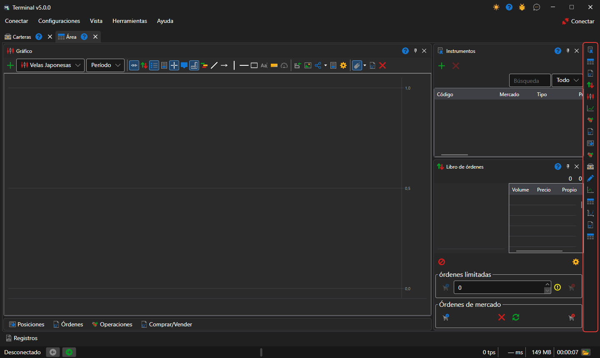
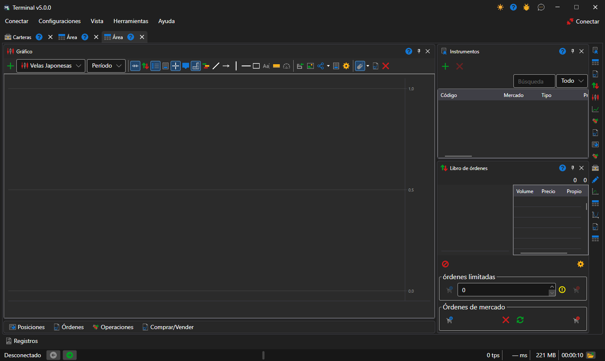

# Área de trabajo

El área de trabajo es una pestaña de la ventana de [Terminal](../../terminal.md) con su propio conjunto de paneles: gráficos, tablas, tickets. Puede haber tantas áreas como se quiera, y cada una funciona por su cuenta: el instrumento seleccionado en una no cambia los paneles de otra.

Una nueva área se crea con la opción **Vista → Área** del [menú principal](ribbon.md), y la actual se renombra con la opción **Vista → Renombrar**.

## Paneles del área

Los paneles se añaden con los botones de la franja vertical del borde derecho del área, un botón por cada [componente](components.md). Cada pulsación abre un panel más de ese tipo, de modo que en un área puede haber, por ejemplo, dos gráficos de instrumentos diferentes. Un panel se puede arrastrar por el título a otro lugar del área, acoplar al borde de un panel vecino, agrupar con él en pestañas o llevar a una ventana aparte.

## Disposición de una nueva área

Una nueva área se organiza como es habitual en los terminales de negociación: el gráfico en el centro, a toda la altura; a la derecha, [Instrumentos](components/instruments.md) encima del [Libro de órdenes](components/order_book.md), y las tablas **Posiciones**, **Órdenes**, **Mis operaciones** y el ticket **Comprar/Vender**, contraídos en una fila de pestañas debajo del gráfico. Un clic en una pestaña despliega las tablas, y el botón de su título las vuelve a contraer. Terminal recuerda si las tablas están contraídas o no junto con la ubicación de los paneles.

Terminal guarda por sí solo la ubicación de los paneles con cada cambio; **Configuraciones → Guardar diseño** (Ctrl+S) la guarda de inmediato, y **Configuraciones → Restablecer diseño** devuelve los paneles a sus posiciones originales.

## Véase también

[Menú principal](ribbon.md)

[Componentes](components.md)
