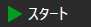

# デバッグ

ストラテジーのテスト過程では、特定のキューブの入力にどのデータが入るのか、またはその出力に何が渡されるのかを確認する必要がしばしばあります。そのために、[Designer](../../designer.md) には **デバッガー** が用意されています。

デバッガーのボタンは、スキーム自体のパネル上、キャンバスの上にあります。ほとんどのボタンにはショートカットキーがあります。**F9** — ブレークポイントを追加、**F10** — 次の要素へ、**F11** — 複合要素の中へ、**Shift+F11** — 複合要素の外へ。ソケットのブレークポイントは、ソケットを右クリックして設定・解除します。次のブレークポイントまでテストを続行するには、**バックテスト** タブの **スタート**（**F5**）ボタンを使います。

デバッガーのボタン:

- **ブレークポイントを追加** – 選択した要素にブレークポイントを追加します。ブレークポイントが追加された要素は赤い枠で強調表示されます。
- **ブレークポイントを削除** – ブレークポイントを削除します。
- **次の要素** – ブレークポイントがトリガーされたとき、スキームの次の要素へ移動します。
- **出力へステップ** – ブレークポイントがトリガーされたとき、現在の要素の出力へ移動します。要素出力で渡された値を確認するために使用します。
- **ステップイン** – ブレークポイントがトリガーされたとき、複合要素の内部へ移動します。複合要素のスキームを自動的に開き、データが最初に送信される要素で停止します。
- **ステップアウト** – ブレークポイントがトリガーされ、複合要素内にいる場合、開いている複合要素が使用されている 1 つ上のレベルへ戻ります。
- **続行** – 次のブレークポイントがトリガーされるまで続行します。これは **バックテスト** タブの **スタート** ボタンで、テスト実行中は **続ける** と表示されます。

## 推奨コンテンツ

[ブレークポイント](debugging/break_points.md)
