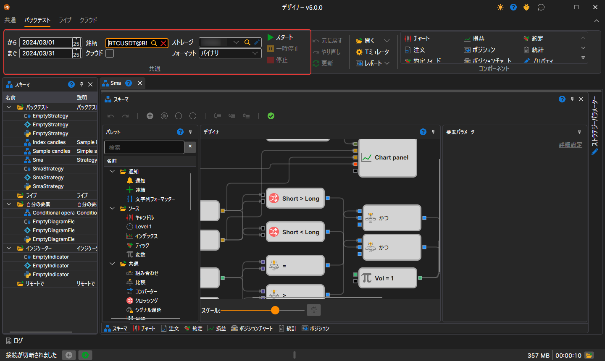
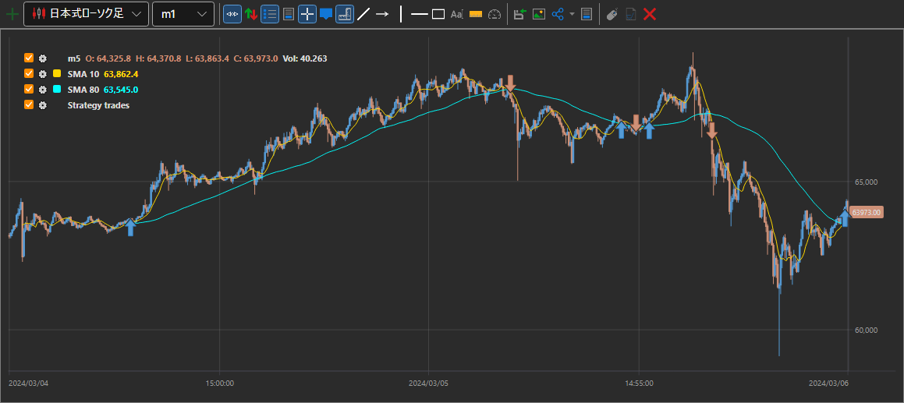
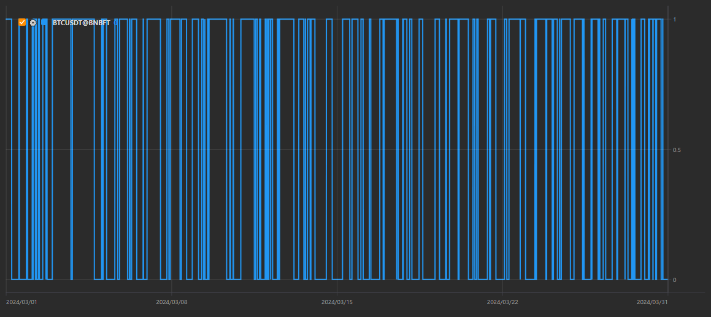
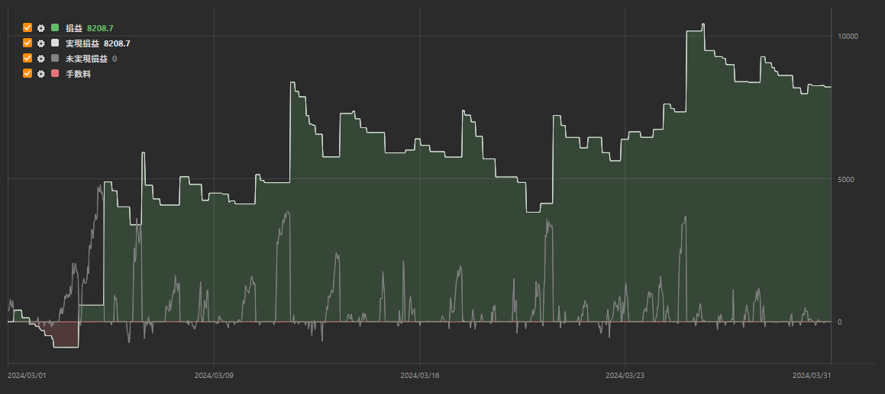

# はじめに

例として、SMA ストラテジーの例を取り上げます。

履歴データでテストを実行するには、履歴データでテストするスキームを持つストラテジーを選択する必要があります。ストラテジーは、ストラテジーフォルダー内の [スキームパネル](../user_interface/schemas.md) で、対象のストラテジーをダブルクリックして選択します。

テストの前に、マーケットデータ（銘柄、ローソク足、ティック約定、または板）を読み込みます。これは [マーケットデータストレージ](../market_data_storage.md) で説明されています。

ストラテジーのタブに切り替えると、リボンの **バックテスト** タブが自動的に開きます。このタブでテスト期間（**から** と **まで**）を設定し、**銘柄** フィールドで銘柄を選択し、**ストレージ** と **フォーマット** フィールドでマーケットデータのストレージ（[マーケットデータストレージ](../market_data_storage.md)）とその保存形式を指定します。

SMA ストラテジーの例では、次のパラメーターを使用します。

1. 銘柄 BTCUSDT@BNBFT
2. 期間は 2024 年 3 月 1 日から 2024 年 3 月 31 日まで
3. この期間のこの銘柄のローソク足が読み込まれているストレージ
4. ストレージ形式 **バイナリ**

ストラテジー自体は、5 分のローソク足から 2 本の移動平均（**SMA 10** と **SMA 80**）を描き、スキーム上の **Vol = 1** キューブで指定された数量で取引します。

必要なすべてのパラメーターを設定したら、 ボタンをクリックしてストラテジーのテストを開始します。

テスト中またはテスト後に、テスト情報を含むチャートやテーブルを表示できます。

グラフから、ストラテジーで計画したとおり、移動平均の交差で取引が行われていることがわかります。

**ポジションチャート** では、ストラテジーのポジションが 0 と 1 の間で切り替わっていることがわかります。ストラテジーは、短期移動平均が長期移動平均を下から上へ交差したときに買い、逆方向に交差したときにポジションを閉じます。

**損益** チャートは、テスト期間中にストラテジーの損益がどのように推移したかと、手数料を示します。

## 推奨コンテンツ

[ライブ実行](../live_execution/getting_started.md)
