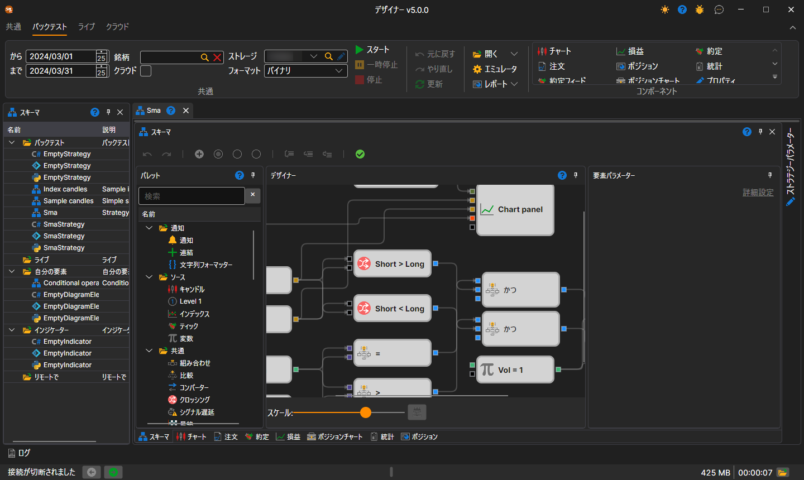
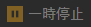
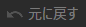
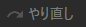

# ユーザーインターフェイス

履歴データでテストを実行するには、履歴データでテストするスキーマを持つストラテジーを選択する必要があります。ストラテジーは、ストラテジーフォルダー内の [スキーマ](../user_interface/schemas.md) パネルで、対象のストラテジーをダブルクリックして選択します。ストラテジーを選択すると、ワークスペースにストラテジーの新しいタブが表示され、このタブに切り替えると、リボンの **バックテスト** タブが自動的に開きます。

**バックテスト** タブの **共通** グループでは、テスト期間（**から** と **まで**）、**銘柄**、マーケットデータのストレージ（**ストレージ**）、およびその保存形式（**フォーマット**）を設定します。**クラウド** チェックボックスをオンにすると、テストはこのコンピューターではなく StockSharp のクラウドで実行されます。

テスト用ストラテジーは、**スタート** ボタン  をクリックして開始します。テスト用ストラテジーを開始すると、テストを一時停止する **一時停止**  ボタンと、テストを完全に停止する **停止**  ボタンがアクティブになります。ストラテジーを編集する際には、最後の操作を取り消す **元に戻す** (Ctrl+Z) 、取り消した操作を戻す **やり直し** (Ctrl+Y) 、スキーマを完全に更新する **更新** (Ctrl+R)  ボタンが便利です。

タブのその他のボタン:

- **開く** — 同じストラテジーを[最適化](../optimization/brute_force.md)用または[取引](../live_execution/getting_started.md)用に開きます。
- **エミュレータ** — [エミュレーション設定](../user_interface/components/backtesting_settings.md)。
- **レポート** — 実行したテストのレポートを Excel、JSON、XML、または CSV 形式で作成します。
- **コンポーネント** グループ — ストラテジータブに追加できるコンポーネント（チャート、損益、約定など）。

[デバッガー](debugging.md)（ブレークポイントとステップ実行）は **スキーマ** パネルにあります。

選択したストラテジータブには、既定で次のパネルが含まれます。

- **スキーマ** パネル。キューブと接続線を組み合わせて、ストラテジーとそのコンポーネントの設計に関する主な作業を行います。スキーマについては、[ダイアグラムパネル](../strategies/using_visual_designer/diagram_panel.md) セクションで詳しく説明しています。
- 情報コンポーネントのパネル（**チャート**、**注文**、**約定**、**損益**、**ポジションチャート**、**統計**、**ポジション**）。スキーマの下にタブとして表示されます。
- **ストラテジーパラメーター** パネル。既定ではストラテジータブの右端に折りたたまれており、起動前に変更できるスキーマのパラメーターが表示されます。

## 推奨コンテンツ

[バックテスト設定](../user_interface/components/backtesting_settings.md)
