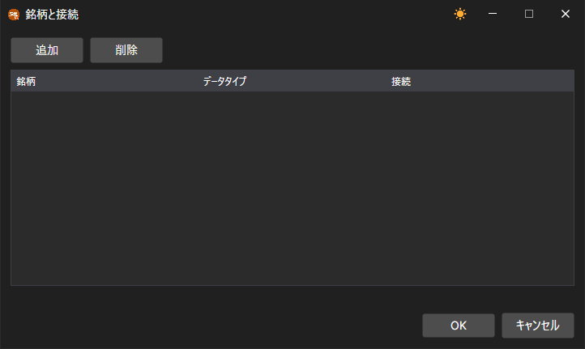

# シンボルマッピング

異なる取引システムでは、同じ銘柄が異なる名前で呼ばれる場合があり、その銘柄のデータと注文が異なる接続を通じてやり取りされることもあります。そのために、[Designer](../../designer.md) には 3 つのウィンドウがあります。

## コードマッピング

マーケットデータパネルの **コードマッピング** ボタンをクリックすると、**銘柄コード <\-> アダプターコード** ウィンドウが開きます。テーブル上部のリストで接続を選択し、 ボタンで行を追加し、削除ボタンで選択した行を削除します。**銘柄コード** 列と **取引所ボードコード** 列には **Designer** での銘柄の名前を、**アダプターのコード** 列と **アダプター内の取引所ボードコード** 列には、選択した接続での銘柄の名前を指定します。

## 銘柄と接続

**共通** タブの **接続する** ボタンのドロップダウンリストにある **銘柄と接続** 項目を選ぶと、銘柄とデータタイプごとに、そのデータを受信する接続を選択するウィンドウが開きます。**追加** ボタンで行を追加し、その行の **銘柄**、**データタイプ**、**接続** 列を入力します。**削除** ボタンは選択した行を削除します。

## ポートフォリオと接続

同じリストの **ポートフォリオと接続** 項目を選ぶと、ポートフォリオ用の同様のウィンドウが開きます。**ポートフォリオ** 列でポートフォリオを指定し、**接続** 列で、そのポートフォリオの注文を送信する接続を指定します。

[Terminal](../../terminal.md) では、どちらのウィンドウも [メインメニュー](../../terminal/user_interface/ribbon.md) の **設定** メニューから開きます。
