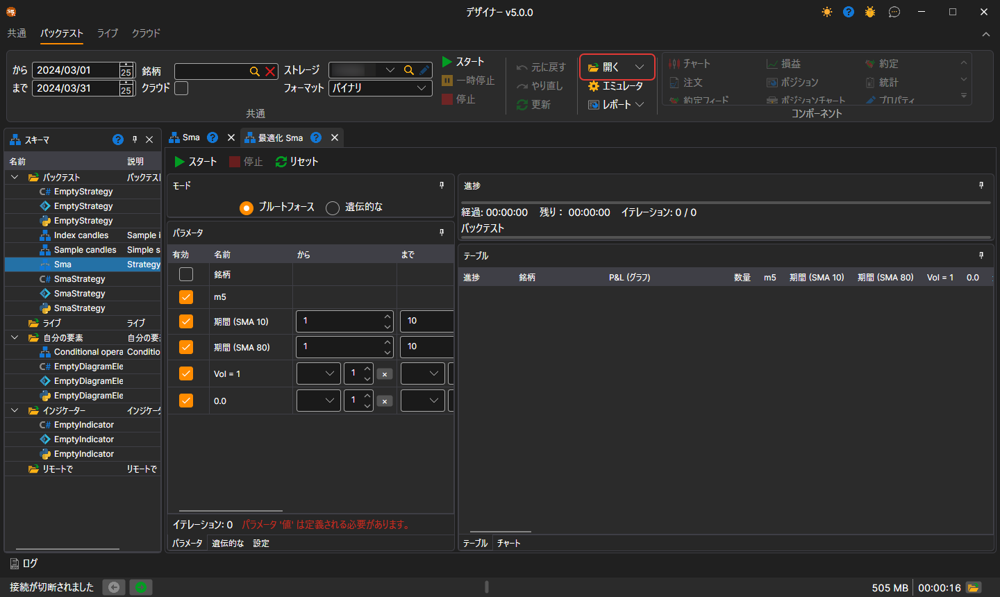
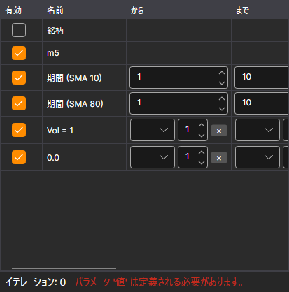
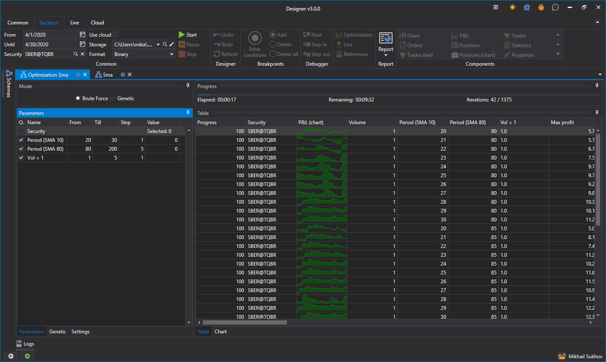
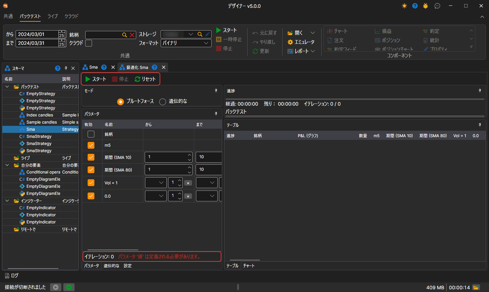

# 総当たり

ストラテジー最適化モードに切り替えるには、**バックテスト** タブで **開く** ドロップダウンリストを開き、**最適化** を選択します。最適化の例は、[キューブから](../strategies/using_visual_designer/first_strategy.md)作成した SMA ストラテジーを使用して説明します。

ワークスペースに「最適化 + ストラテジー名」という名前のタブが開きます。**最適化** タブは 2 つの領域に分かれています。左側は何をどのように最適化するか、右側は最適化の結果です。

- 左上には **モード**（**ブルートフォース** または **遺伝的な**）があります。その下にタブがあります。**パラメータ** — [反復処理される](optimization_parameters.md)ストラテジーパラメーター、**遺伝的な** — [遺伝的最適化](genetic.md)の設定、**設定** — エミュレーションとオプティマイザー自体の設定です。たとえば、同時に実行する回数（**パラレル**）や許容される反復回数（**イテレーション**）を指定できます。
- 右側には **進捗** があり、経過時間、おおよその残り時間、および予定された反復のうち実行済みの回数が表示されます。その下には、各行が一意のパラメーターでストラテジーをテストした結果である **テーブル** タブと、結果を [3D チャート](3d_chart.md) 形式で表示する **チャート** タブがあります。

反復処理用のパラメーターを設定すると、1000 回を超える反復が発生します。オプティマイザーを開始すると、結果の上部にある進行状況に、予定されている反復回数、すでに完了した回数、および完了までにおおよそ必要な時間に関するデータが表示されます。

## パラメーターテーブルとパネルのボタン

パラメーターテーブルでは、各行について、指定した **から**、**まで**、**ステップ** で得られる値の数（**カウント** 列）と、その行の問題（**エラー** 列）を確認できます。たとえば、反復処理が上限に届かないステップなどです。テーブルの下には、すべてのパラメーターを組み合わせた総当たりで実行される回数と、最初のエラー（ある場合）が表示されます。

**スタート**、**停止**、**リセット** ボタンはオプティマイザーパネル上にあり、その下に現在の実行の進行状況バーがあります。結果テーブルには、その実行で使用された **銘柄** の列があります。

## 関連項目

[バックテストの例](../backtesting/getting_started.md)
