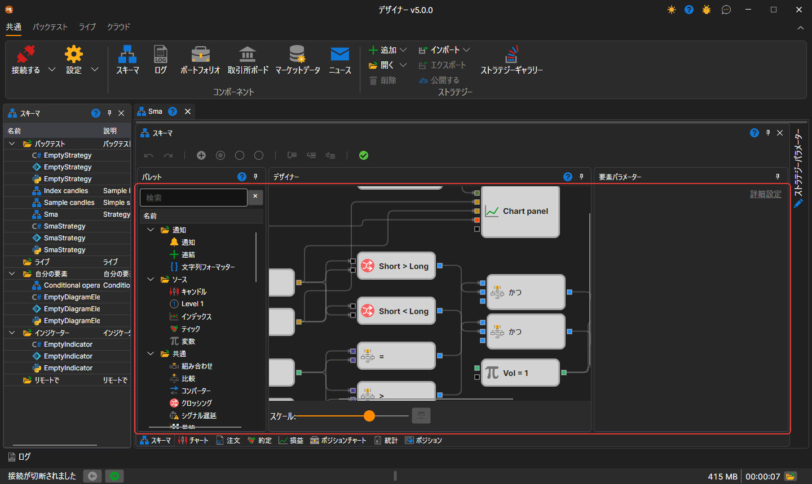
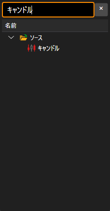
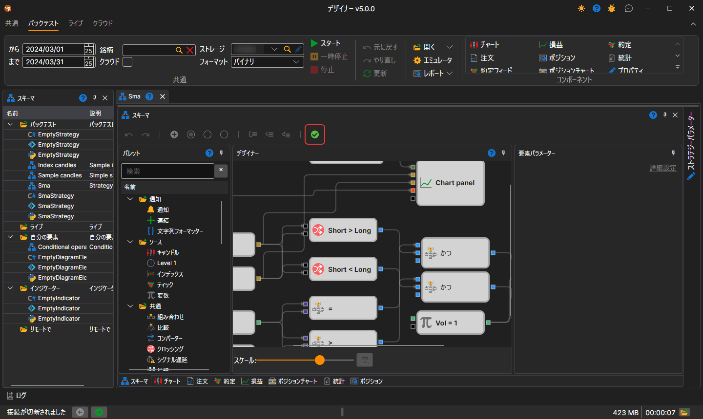
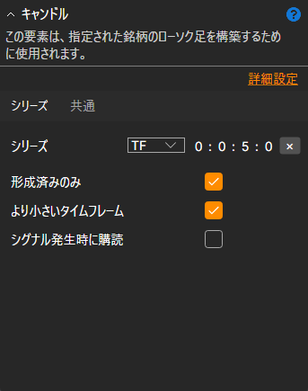
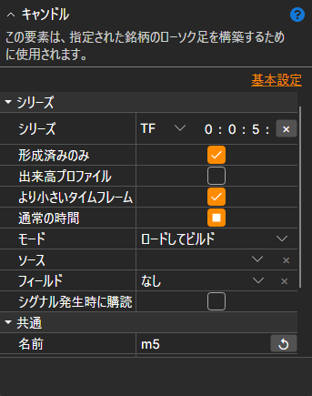

# ストラテジーデザイナー

ストラテジーとその構成要素を設計する主な作業は、ブロックと接続線を組み合わせることで **スキーム** パネル上で行います。スキーム パネルは、**パレット**、**デザイナー**、**要素パラメーター** の各パネルで構成されています。

## パレット パネル

**パレット** パネルには、ストラテジーの作成に使用するブロックが含まれています。パレット内のすべての要素はカテゴリに分けられており、[ブロックの説明](elements.md)セクションで説明されています。ブロックを **デザイナー** パネルに追加するには、必要なブロックをマウスの左ボタンで押し、ボタンを放さずに **デザイナー** パネルへドラッグします。ブロックをダブルクリックすると、**デザイナー** パネルの中央に配置されます。その後、その要素が自動的に選択され、ブロックのプロパティを編集するウィンドウにそのパラメーターが表示されます。

パレットの上にある検索行では、名前、説明、カテゴリ名でブロックを検索できます。**Enter** キーを押すと、選択したブロックが **デザイナー** パネルに配置されます。何も選択していない場合は、最初に見つかったブロックが配置されます。

## Designer パネル

**Designer** パネルでは、ブロックと接続（線）を組み合わせることで、ストラテジー作成の全プロセスを行います。ここにはストラテジーのスキームが視覚的に表示されます。ストラテジーの作成に関する詳細は、[ブロックからアルゴリズムを作成する](first_strategy.md)セクションで説明されています。

選択したブロックは、キーボードの矢印キーで 1 ステップずつ移動できます。**Shift** を押しながらの場合は 10 ステップずつ移動します。接続線をドラッグしている間は、接続できるソケットだけが強調表示され、線の端は最も近いソケットに自動的に吸着します。

スキームの表示倍率は、パネルの下にある **スケール** スライダー、または **Ctrl** を押しながらマウスホイールを回して変更します。**デザイナー** パネルのキー操作:

| キー | 操作 |
|---|---|
| **Ctrl+Z**、**Ctrl+Y** | 操作を元に戻す、やり直す |
| **Ctrl+C**、**Ctrl+X**、**Ctrl+V** | 選択したブロックをコピー、切り取り、貼り付け |
| **Ctrl+A** | すべてのブロックを選択 |
| **Delete** | 選択したものを削除 |
| **Esc** | 選択を解除する、または線のドラッグを中止する |
| **Ctrl+「+」**、**Ctrl+「−」** | 拡大、縮小 |
| **Ctrl+0** | 元の倍率に戻す |
| **Ctrl+1** | スキーム全体をパネルに合わせる |
| **Alt+Z** | スキームをパネルに合わせる、または前の倍率に戻す |

スキームのパネルにあるチェックマークのボタン（ツールチップは **コードを生成してコンパイルし、図を検証します。**）は、ストラテジーを起動せずにスキームを検証します。スキームにエラーがある場合、そのテキストが **デザイナー** パネルの上に赤字で表示されます。デバッガーのエラーもここに表示されます。

## 要素パラメーター パネル

**要素パラメーター** パネルには、**デザイナー** パネルで選択したブロックのパラメーターが表示されます。選択したブロックは枠で強調表示されます。

**要素パラメーター** パネルは、*基本設定* と *詳細設定* の 2 つのモードで表示できます。

デフォルトでは、スキームの構築時に、プロパティは最初に *基本設定* モードで表示されます。*詳細設定* モードに切り替えるには、対応するタイトルをクリックする必要があります。

*基本設定* モードでは、ブロックの最も必要なプロパティだけが表示されます。たとえば、[ローソク足](elements/data_sources/candles.md) ブロックでは、タイムフレーム、形成済みローソク足のみを受信するためのフラグ、より小さいタイムフレームからローソク足を構築できるかどうかのフラグ、およびシグナル時にローソク足を購読するためのフラグが表示されます。

*詳細設定* モードでは、変更および設定が可能なブロックのすべてのプロパティが表示されます。

すべてのブロックには、*詳細設定* モードで表示される定義済みプロパティのセットがあります。

- **名前** - デザイナーに表示される要素の名前。
- **ログレベル** - この要素のログ記録レベル。
- **パラメーター** - 上位レベルの要素に要素のパラメーターを表示します。
- **ソケット** - 上位レベルの要素に要素のソケットを表示します。

各ブロックのプロパティに関する詳細は、[ブロックの説明](elements.md)セクションで説明されています。

## 関連項目

[ブロックの説明](elements.md)

