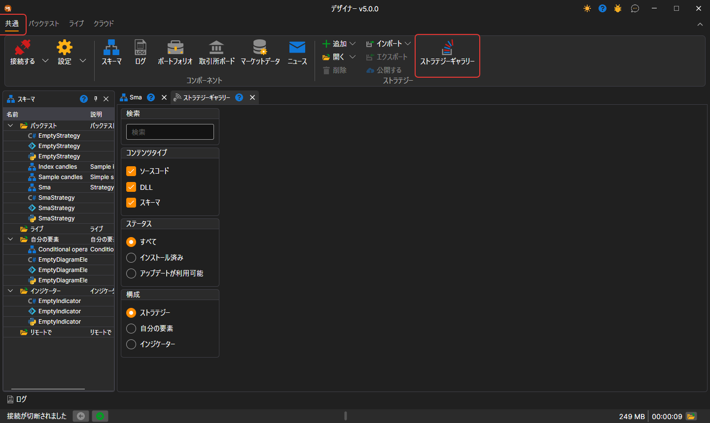

# ストラテジーギャラリー

**戦略ギャラリー** では、既製の取引ストラテジーをコンピューターにダウンロードできます。**共通** タブの **戦略ギャラリー** ボタンをクリックすると、**戦略ギャラリー** を開くことができます。

ストラテジーのカードは、サイトからカタログを読み込むにつれて表示されます。読み込み中は、パネルに **ギャラリーからストラテジーを読み込み中...** と表示されます。カタログを読み込めなかった場合、パネルにはその原因と、読み込みを再試行する **更新** ボタンが表示されます。

ストラテジーをコンピューターにダウンロードするには、次の操作が必要です:

- 目的のストラテジーを選択し、ダウンロードボタンをクリックします:

  

- ストラテジーが **バックテスト** セクションのストラテジーツリーに追加されます:

  

## 関連項目

[ストラテジーの公開](strategy_gallery/publish_own_strategy.md)
