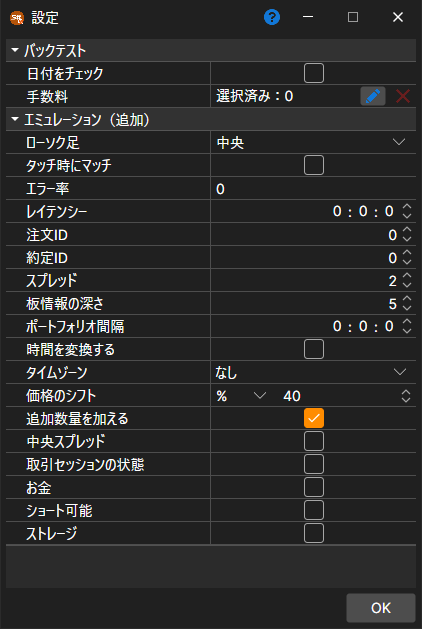

# バックテスト設定

エミュレーション設定は、履歴データでのテストまたは最適化のためにストラテジーを開いているときに、リボンの **バックテスト** タブにある **エミュレータ** ボタンで開きます。プロパティを選択すると、その詳細な説明がウィンドウの下部に表示されます。プロパティは次のようにグループに分類されています。

**バックテスト**

- **日付をチェック** – 読み込む日が取引日かどうかを確認します。
- **[手数料](../commissions.md)** – 手数料（ブローカー手数料、取引所手数料など）です。

**エミュレーション（追加）**

- **ローソク足** – ローソク足でテストする場合に、注文をローソク足のどの価格で約定させるかです。中央値、始値、高値、安値、または終値を選択できます。
- **タッチ時に結合** – エミュレーション中、約定価格が注文価格に触れたとき（つまり注文価格と等しいとき）に注文を結合します。
- **エラー率** – 新規注文の登録時に発生するエラーの割合値です。値は 0（エラーなし）から 100 まで指定できます。
- **レイテンシー** – 登録された注文レイテンシーの最小値です。
- **注文 ID** – エミュレーターが注文の識別子を生成し始める番号です。
- **約定 ID** – エミュレーターが約定の識別子を生成し始める番号です。
- **スプレッド** – 価格ステップ単位のスプレッドサイズです。ティック約定から板情報を生成する際に、スプレッドを指定するために使用されます。
- **板の深さ** – ティックから生成される板情報の最大深度です。
- **ポートフォリオ間隔** – ポートフォリオ再計算の間隔です。間隔がゼロの場合、再計算は実行されません。
- **時刻変更** – 注文と約定の時刻を取引所時刻に変更します。
- **タイムゾーン** – 取引所のタイムゾーンです。
- **価格シフト** – 最終約定からの価格シフトで、次のセッションの最大価格と最小価格の制限を指定します。
- **追加数量** – 大きな数量の注文が登録されるときに、板情報へ追加数量を加えます。
- **中央スプレッド** – どちらの側が取引したかわからない価格（たとえばローソク足の価格）の周りにスプレッドを均等に配分し、買いと売りが同じ半分のスプレッドを支払うようにします。
- **取引セッションの状態** – 取引状態を確認します。
- **お金** – 資金残高を確認します。
- **ショート可能** – ショートポジションを建てられるかどうかです。
- **ストレージ** – エミュレーターが作成するメッセージの保存を許可します。

テスト期間、銘柄、マーケットデータのストレージとその形式は **バックテスト** タブ自体で設定し（[ユーザーインターフェイス](../../backtesting/user_interface.md)）、スキームのパラメーターはストラテジータブの右端にある **ストラテジーパラメーター** パネルで設定します。

## 推奨コンテンツ

[チャート](chart.md)
