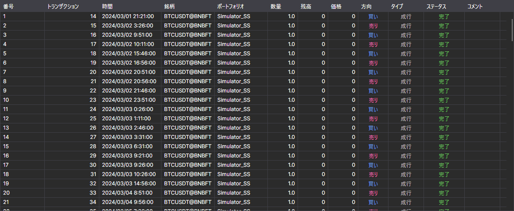

# 注文

**注文** コンポーネントは注文のテーブルで、ストラテジーのすべての注文に関する完全な情報を表示します。

テーブル上部のリストで、表示する注文を選択します。**すべて**、アクティブな注文のみ（**アクティブ**）、約定済みの注文（**完了**）、または拒否された注文（**失敗**）です。

テーブルの行のコピー、検索とフィルター、列の設定については、[テーブルの操作](../../../terminal/user_interface/tables.md) セクションで説明しています。

## 推奨コンテンツ

[約定](trades.md)
